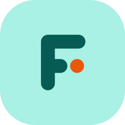

# Findex

[](https://github.com/aiyu-ayaan/Findex/commits/master)
[](LICENSE)
[](https://github.com/aiyu-ayaan/Findex/releases)


A modern, native Android file explorer built with **Jetpack Compose** and **Material 3 Expressive** design. Findex combines fluid motion, expressive shape morphing, multi-tab multitasking, deep storage analytics, an encrypted vault, network storage (SMB, WebDAV, FTP, SFTP), and powerful archive utilities into a fast, privacy-respecting file manager. It can also share your phone's files with a computer's browser over Wi-Fi.

---

## 🎬 Intro video

<p align="center">
  <a href="intro-video.mp4">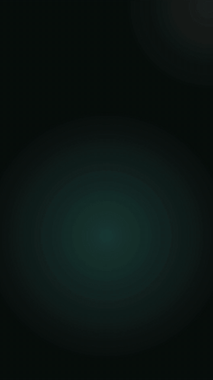</a>
</p>

---

## 📸 Screenshots

<p align="center">
  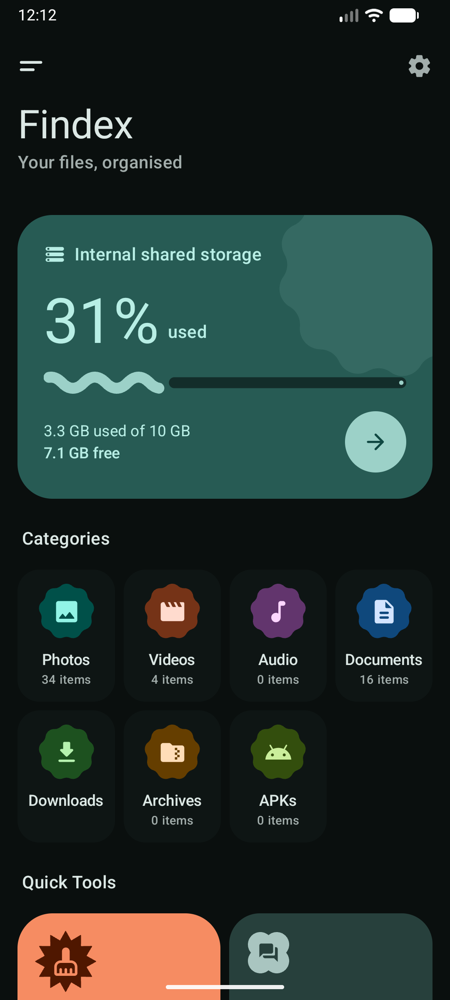
  &nbsp;&nbsp;
  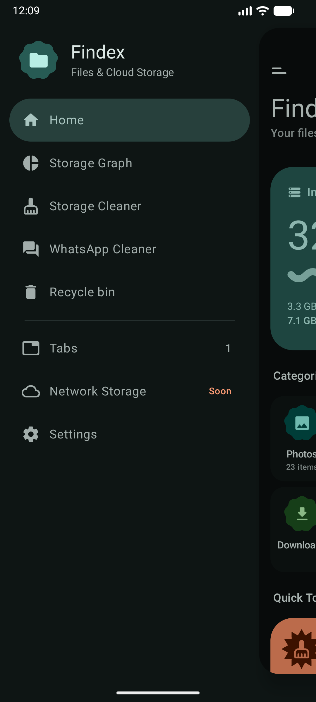
  &nbsp;&nbsp;
  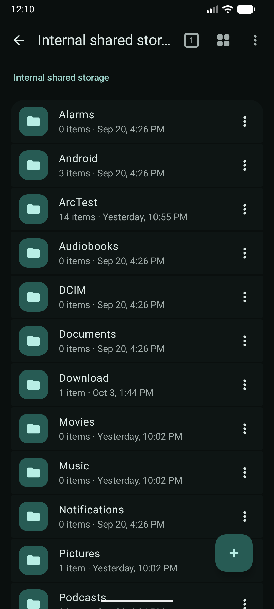
</p>

<p align="center">
  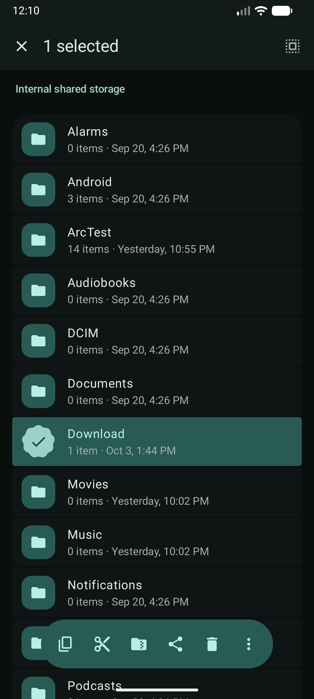
  &nbsp;&nbsp;
  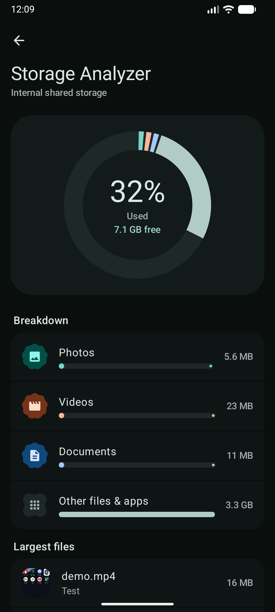
  &nbsp;&nbsp;
  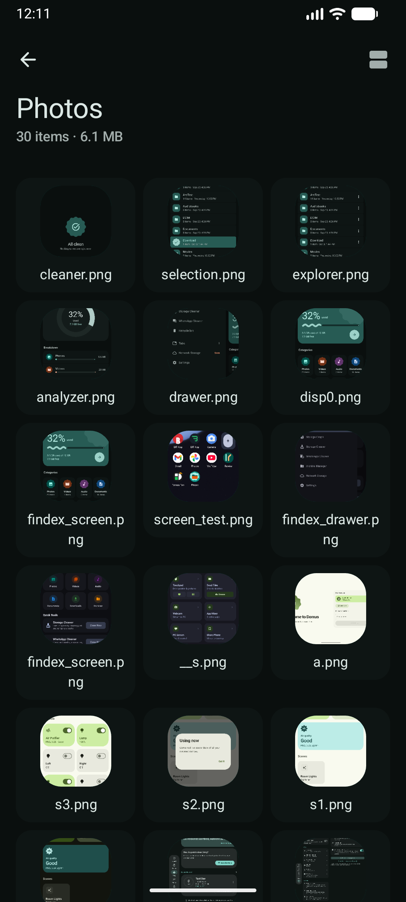
</p>

---

## ✨ Features

### Explore & organize
- **Explorer**: list/grid, sort, hidden files, thumbnails for images, video, PDF, APK and audio art, predictive back and shared-axis motion.
- **Multi-tab multitasking**: open many folders at once, copy/cut/paste across tabs through one clipboard, tabs restored on cold start.
- **Dual pane**: two folders side by side (stacked on phones). Copy, move and delete across panes. **Folder compare** marks only-here, newer, older, different and same, and can select what the other pane is missing.
- **Selection like Google Photos**: long-press, swipe to range-select, or tap items after the first. Floating toolbar for copy, cut, compress, delete, share.
- **Global search** over the MediaStore index, **recent files**, **favorites and colored tags**, shortcuts, recent changes.
- **Batch rename** with preview and conflict checks.
- **Recycle Bin**: per-volume `.FindexTrash`, undo, 30-day purge.

### Storage tools
- **Storage analyzer**: circular gauge, category breakdown (Photos, Videos, Audio, Documents, Apps, Archives), growth history.
- **Large file finder** and **duplicate finder** (staged hashing, keep-one guard).
- **Storage Cleaner**: junk, obsolete APKs, cache artifacts, empty folder trees and empty files.
- **App Cleaner**: leftover folders of uninstalled apps in `Android/media`, `data`, `obb`, plus reachable app caches.
- **Social media cleaners**: WhatsApp, Telegram and Instagram media by type and direction.
- **Image compression** in batch.

### Archives
- Create ZIP (AES-256 password), 7z, TAR, TAR.GZ.
- Extract ZIP, 7z, RAR/RAR5, TAR, TAR.XZ/BZ2.
- Browse an archive and open single entries without full extraction.
- 16 KB page-size compliant native binaries for Android 15+.

### Network & sharing
- **Network storage**: SMB, WebDAV, FTP, SFTP. Shares open as normal Explorer tabs, with live status, thumbnails and video streaming. Passwords are Keystore-encrypted, or session-only.
- **Share this phone**: local web server with address and random 6-digit PIN. Browse, preview, download, upload, rename and delete from a computer's browser. Access presets (View / Download / Full) apply live. Stops itself after an idle timeout. Plain HTTP: trusted networks only.

### Privacy & viewers
- **Encrypted Vault**: password and biometric unlock, encrypted at rest, locks when the app leaves the screen.
- **Built-in viewers**: image/video gallery, text/code, PDF, audio player, plus a file hash calculator and media metadata inspector.

### Platform & design
- **Material 3 Expressive**: dynamic color, shape morphing (`Cookie`, `Scallop`, `Clover`, `Pill`), wavy progress, push drawer with spring physics.
- **Foreground operation queue**: copy, move, compress, extract, delete and clean run in `FileOperationForegroundService`, cancellable, with notification progress.
- **Adaptive tablet layout**: navigation rail, permanent drawer, list-detail with inspector pane.
- **In-app updates**: daily background check, release notes, Updates screen.

---

## 🧭 How it works

### Modules

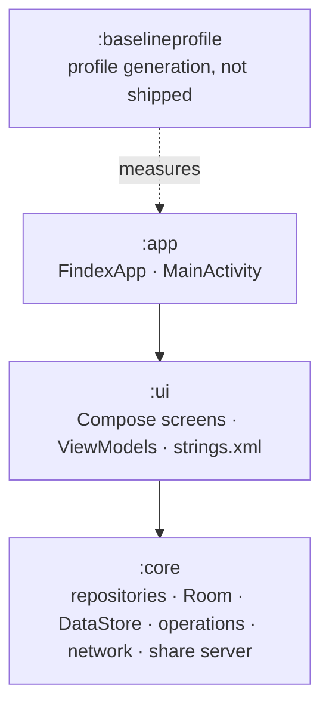

### Long file operations

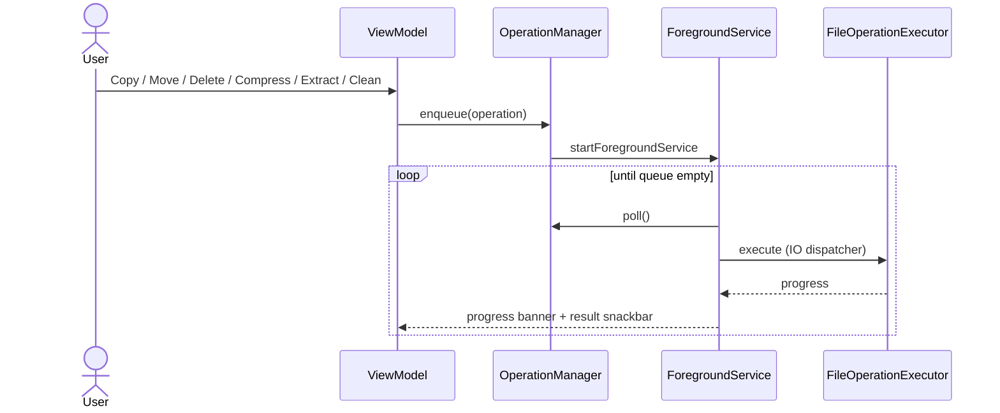

### Storage sources

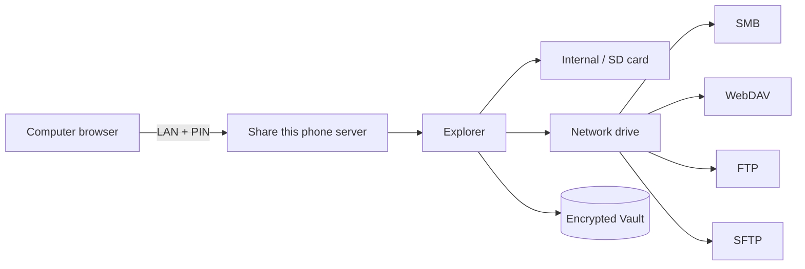

More diagrams: [ARCHITECTURE.md](development/docs/ARCHITECTURE.md).

---

## 🏗️ Architecture

Findex follows Clean Architecture principles with decoupled Gradle modules:

```
├── app/    # Application entry point, Hilt Android App, MainActivity, Permissions
├── core/   # File engines, Room DB (SQLite), DataStore, network clients, share server, Foreground Services, Repositories
├── ui/     # Jetpack Compose UI, Material 3 Expressive Theme, ViewModels, centralized strings.xml
└── baselineprofile/  # Baseline + startup profile generation (not shipped)
```

| Module | Responsibility | Localization Rule |
| :--- | :--- | :--- |
| `:app` | App manifest, Hilt injection root, application lifecycle | No strings (merges from `:ui`) |
| `:core` | Storage engines, SQLite Room DB, background operations | No strings (delegates via `OperationStrings` interface) |
| `:ui` | Compose screens, expressive components, navigation | **Single source of truth**: all strings live in `ui/src/main/res/values/strings.xml` |

---

## 🚀 Getting Started

### Prerequisites

- Android SDK with platform 37 (compileSdk 37); runs on Android 8.0+ (minSdk 26)
- Java 17+ (or OpenJDK 17)
- Connected Android device or running emulator

### Build & Run

Use the included helper script `run.sh` to build, install, and launch the application directly:

```bash
# Build, install, and launch Findex on your connected device/emulator
./run.sh

# Build, launch, and follow logcat output
./run.sh --logs

# Clean build and launch
./run.sh --clean --logs
```

### Building Release APK

To build an optimized, R8-minified release APK:

```bash
./build-release.sh
```

---

## 🖥️ Emulator Display & DPI Resolution

If your emulator was previously toggled to a tablet resolution or has custom window manager overrides, you may notice black bars or tablet desktop layout on a mobile emulator.

You can instantly restore your emulator to its native physical resolution and density:

```bash
# Option 1: Using run.sh
./run.sh --reset-display

# Option 2: Using adb directly
adb shell wm size reset
adb shell wm density reset
```

> **Note**: `./run.sh` automatically checks for active display overrides and resets them to the device's physical defaults.

---

## 📄 License

This project is licensed under the **Apache License 2.0**, Copyright 2026 **Ayaan**. See [LICENSE](LICENSE) for details.
