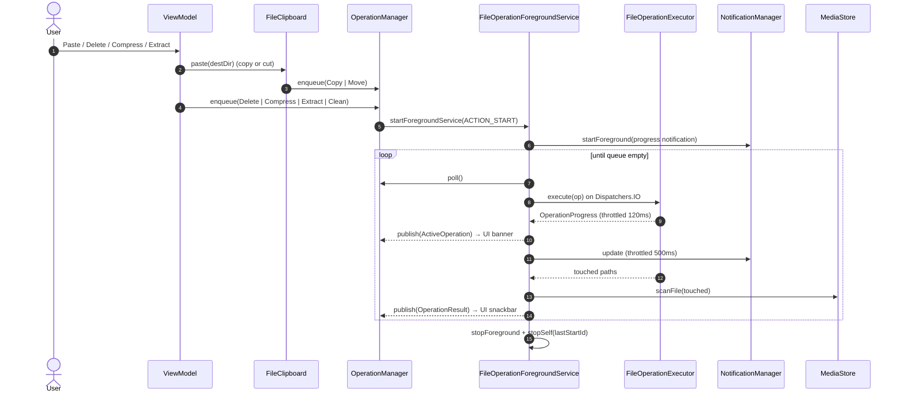
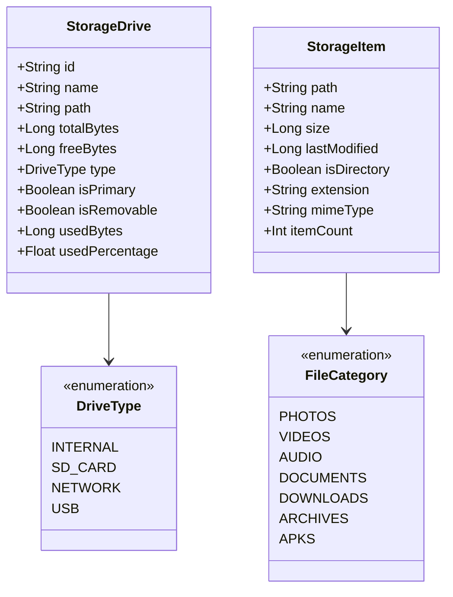
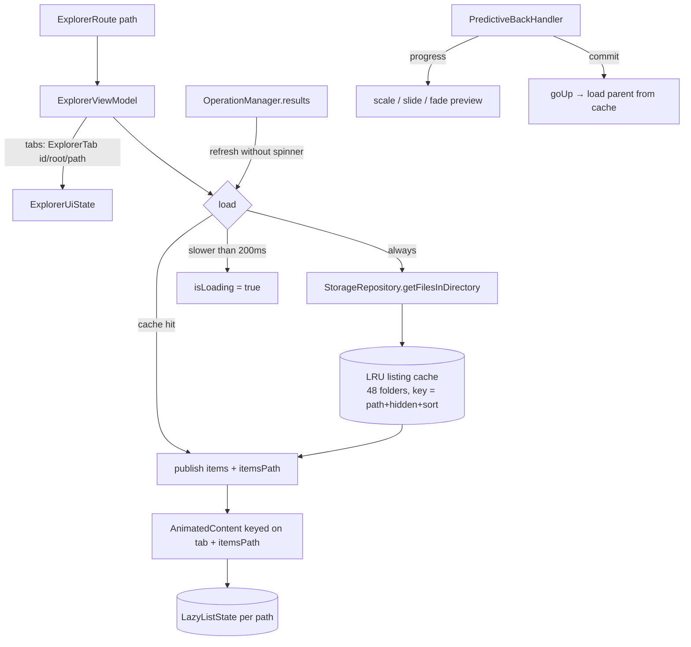

# Findex Architecture

Findex is a native Android file explorer built with Kotlin, Jetpack Compose, Material 3 Expressive design, and Hilt. It is designed to support rich file operations, storage analytics, clean-up tools (including WhatsApp media cleanup), multi-format archive creation and extraction (7z, RAR, ZIP), multitasking tabs, and network storage (e.g. Windows SMB).

---

## 1. Module Architecture

The application is structured into three distinct Gradle modules adhering to clean architecture separation:

### Module Responsibilities

| Module | Type | Purpose | Localization Rule |
| :--- | :--- | :--- | :--- |
| `:app` | `com.android.application` | Application entry point (`FindexApp` with `@HiltAndroidApp`), `MainActivity`, Android Manifest, system permissions. | **NO `strings.xml`** (pulls merged resources from `:ui`). |
| `:ui` | `com.android.library` | Compose UI components, Material 3 Expressive theming, navigation drawer, screen layouts, ViewModels. | **Centralized `strings.xml`** holding all app strings for future localization. |
| `:core` | `com.android.library` | Models, repositories, Room database, DataStore settings, operation queue, foreground service, Hilt bindings. | **NO `strings.xml`**. Notification texts come from `OperationStrings`, implemented in `:ui`. |

### Persistence rule

| Store | Holds | Never holds |
| :--- | :--- | :--- |
| Room (SQLite) `findex.db` | Bookmarks, recent files, (post-MVP) network drives | Settings |
| DataStore `settings` | Theme mode, dynamic color, hidden files, grid view, sort | Lists / records |

---

## 2. Foreground Service & Long Operations Architecture

Every copy, move, delete, clean, compress and extract runs in `FileOperationForegroundService`.
The UI never runs these on a ViewModel scope.

**Cancel**: notification action or UI → `ACTION_CANCEL` → current job cancelled. The executor checks
cancellation every 256 KB chunk, deletes the half-written file, and zip4j tasks get `isCancelAllTasks`.

**Safety rules in the executor**
- Never overwrites: name clashes become `name (1).ext`.
- Refuses to copy/move a folder into itself.
- Move tries `renameTo` first (instant on the same volume), falls back to copy + delete.
- A failed compress deletes the partial archive.

## 3. Storage Hierarchy & Network Drive Integration

---

## 4. Standalone Runner (`run.sh`)

For developers without Android Studio installed, `run.sh` provides a complete headless CLI build-and-run workflow:

1. Auto-resolves `ANDROID_HOME` (`$HOME/Android/Sdk`).
2. Checks for running Android devices or emulators via `adb devices`.
3. If no emulator is running, automatically lists AVDs via `emulator -list-avds` and launches the available AVD in the background.
4. Waits for `adb wait-for-device` and polls `sys.boot_completed=1`.
5. Executes `./gradlew :app:installDebug`.
6. Launches `com.aiyu.findex.debug/com.aiyu.findex.MainActivity` with `am start`.
7. Supports `--logs` / `-l` for continuous logcat streaming.

---

## 5. Explorer State & Listing Cache

- **Selection** lives in `ExplorerUiState.selection` (paths). Long-press + drag selects a range
  (`dragToSelect` in `ExplorerContent.kt`) with edge auto-scroll; tap toggles while selecting.
- **Clipboard** is app-wide (`FileClipboard`), so copy in one tab and paste in another.

## 6. Tools

| Screen | ViewModel | Data |
| :--- | :--- | :--- |
| Storage Analyzer | `AnalyzerViewModel` | `StorageRepository.getCategoryStats()` + `StorageScanner.largestFiles()` |
| Storage Cleaner | `CleanerViewModel : CleanViewModel<JunkType>` | `StorageScanner.scanJunk()` → `FileOperation.Clean` via FGS |
| WhatsApp Cleaner | `WhatsAppViewModel : CleanViewModel<WhatsAppMediaType>` | `StorageScanner.scanWhatsApp()` → `FileOperation.Clean` via FGS |

`StorageScanner` skips `Android/data` and `Android/obb` and never offers top-level standard
folders (DCIM, Music…) as "empty folders".
