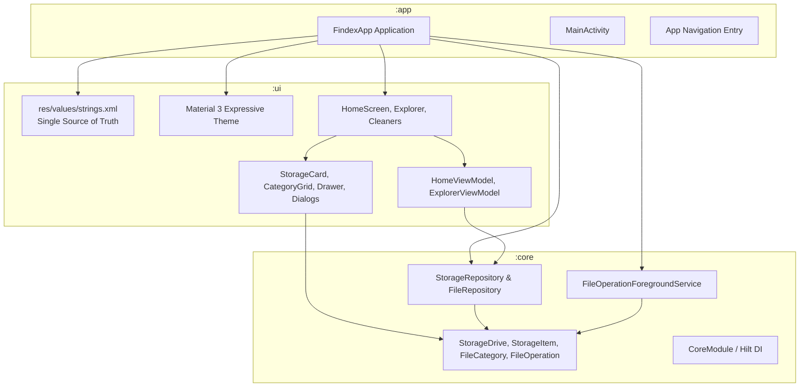
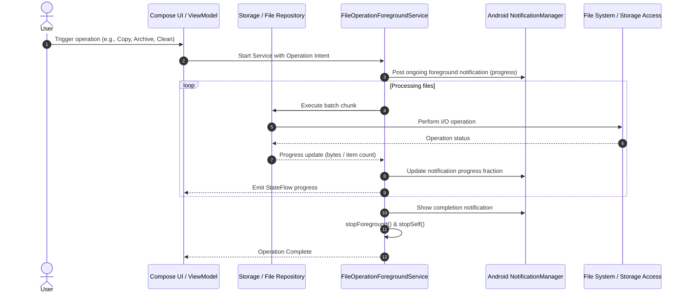
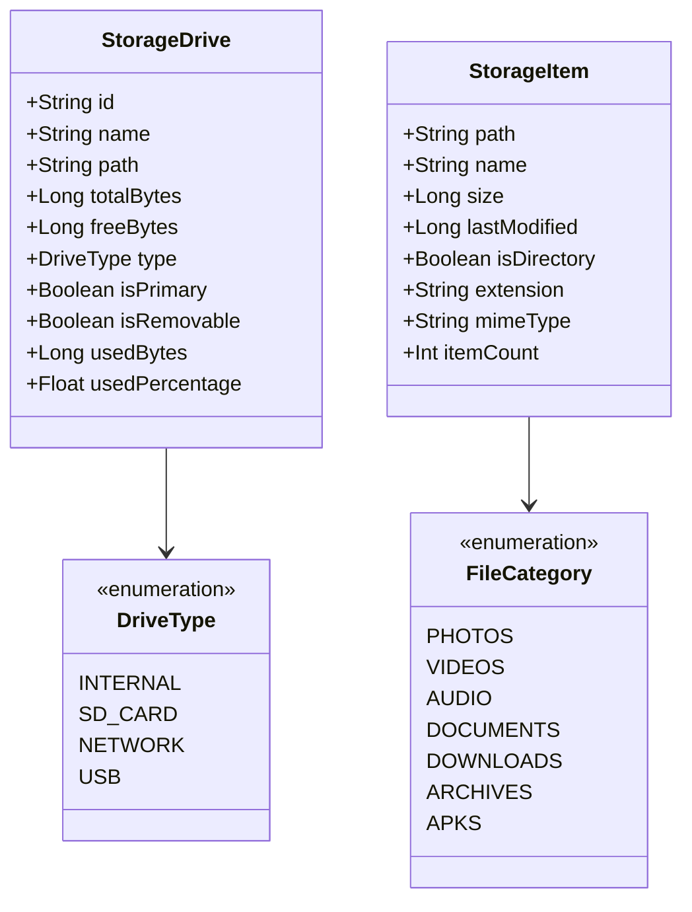

# Findex Architecture

Findex is a native Android file explorer built with Kotlin, Jetpack Compose, Material 3 Expressive design, and Hilt. It is designed to support rich file operations, storage analytics, clean-up tools (including WhatsApp media cleanup), multi-format archive creation and extraction (7z, RAR, ZIP), multitasking tabs, and network storage (e.g. Windows SMB).

---

## 1. Module Architecture

The application is structured into three distinct Gradle modules adhering to clean architecture separation:

### Module Responsibilities

| Module | Type | Purpose | Localization Rule |
| :--- | :--- | :--- | :--- |
| `:app` | `com.android.application` | Application entry point (`FindexApp` with `@HiltAndroidApp`), `MainActivity`, Android Manifest, system permissions. | **NO `strings.xml`** (pulls merged resources from `:ui`). |
| `:ui` | `com.android.library` | Compose UI components, Material 3 Expressive theming, navigation drawer, screen layouts, ViewModels. | **Centralized `strings.xml`** holding all app strings for future localization. |
| `:core` | `com.android.library` | Models, repositories, storage queries, foreground services for background tasks, Hilt bindings. | **NO `strings.xml`**. |

---

## 2. Foreground Service & Long Operations Architecture

Long-running tasks such as batch file copying, moving, archiving, extraction, and junk cleaning run within `FileOperationForegroundService` with notification channel support.

---

## 3. Storage Hierarchy & Network Drive Integration

---

## 4. Standalone Runner (`run.sh`)

For developers without Android Studio installed, `run.sh` provides a complete headless CLI build-and-run workflow:

1. Auto-resolves `ANDROID_HOME` (`$HOME/Android/Sdk`).
2. Checks for running Android devices or emulators via `adb devices`.
3. If no emulator is running, automatically lists AVDs via `emulator -list-avds` and launches the available AVD in the background.
4. Waits for `adb wait-for-device` and polls `sys.boot_completed=1`.
5. Executes `./gradlew :app:installDebug`.
6. Launches `com.aiyu.findex.debug/com.aiyu.findex.MainActivity` with `am start`.
7. Supports `--logs` / `-l` for continuous logcat streaming.
