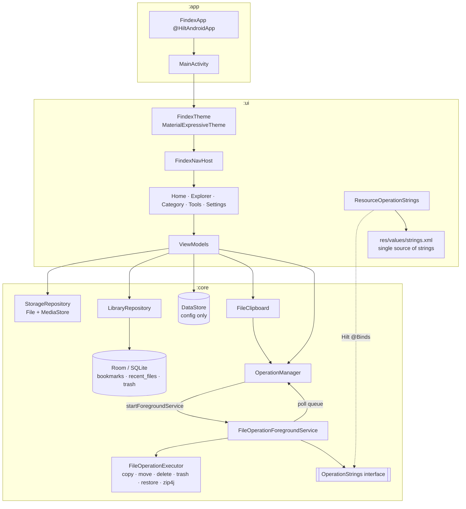
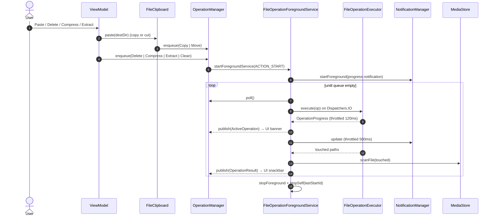
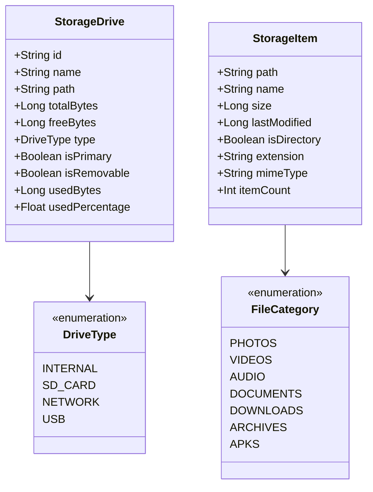
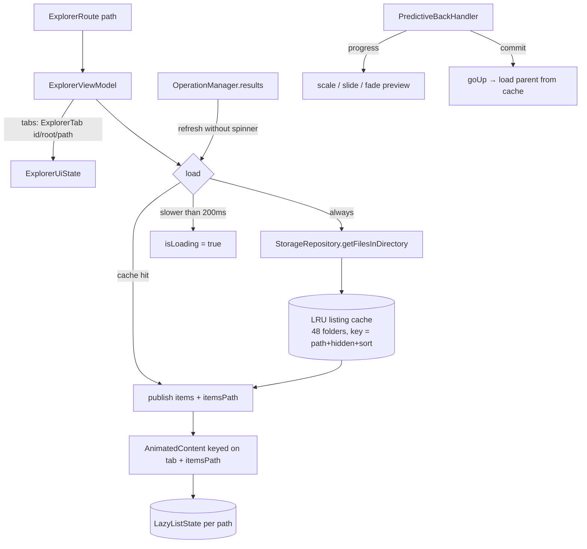
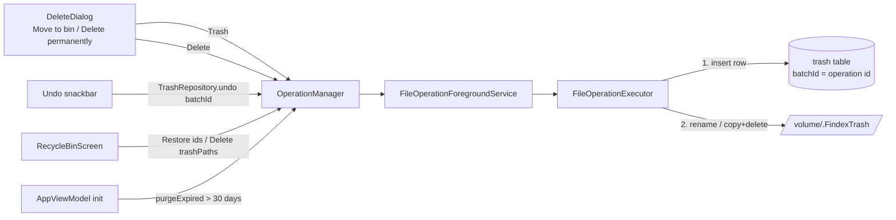
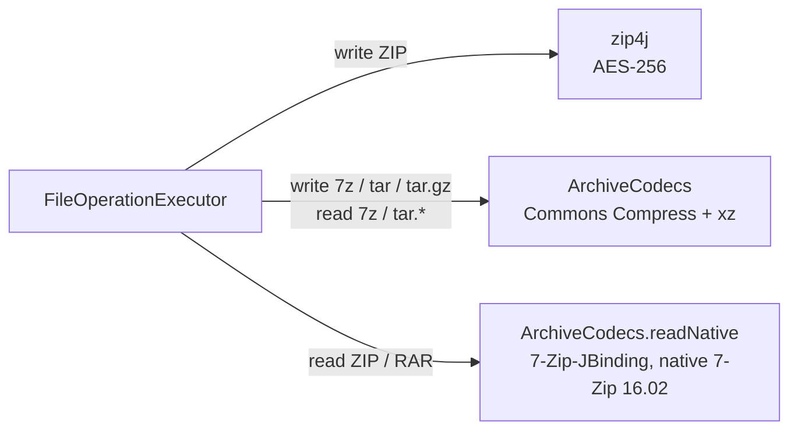

# Findex Architecture

Findex is a native Android file explorer built with Kotlin, Jetpack Compose, Material 3 Expressive design, and Hilt. It is designed to support rich file operations, storage analytics, clean-up tools (including WhatsApp media cleanup), multi-format archive creation and extraction (7z, RAR, ZIP), multitasking tabs, and network storage (e.g. Windows SMB).

---

## 1. Module Architecture

The application is structured into three distinct Gradle modules adhering to clean architecture separation:

### Module Responsibilities

| Module | Type | Purpose | Localization Rule |
| :--- | :--- | :--- | :--- |
| `:app` | `com.android.application` | Application entry point (`FindexApp` with `@HiltAndroidApp`), `MainActivity`, Android Manifest, system permissions. | **NO `strings.xml`** (pulls merged resources from `:ui`). |
| `:ui` | `com.android.library` | Compose UI components, Material 3 Expressive theming, navigation drawer, screen layouts, ViewModels. | **Centralized `strings.xml`** holding all app strings for future localization. |
| `:core` | `com.android.library` | Models, repositories, Room database, DataStore settings, operation queue, foreground service, Hilt bindings. | **NO `strings.xml`**. Notification texts come from `OperationStrings`, implemented in `:ui`. |

### Persistence rule

| Store | Holds | Never holds |
| :--- | :--- | :--- |
| Room (SQLite) `findex.db` | Bookmarks, recent files, recycle bin entries, (post-MVP) network drives | Settings |
| DataStore `settings` | Theme mode, dynamic color, hidden files, grid view, sort | Lists / records |

---

## 2. Foreground Service & Long Operations Architecture

Every copy, move, delete, clean, compress and extract runs in `FileOperationForegroundService`.
The UI never runs these on a ViewModel scope.

**Cancel**: notification action or UI → `ACTION_CANCEL` → current job cancelled. The executor checks
cancellation every 256 KB chunk, deletes the half-written file, and zip4j tasks get `isCancelAllTasks`.

**Safety rules in the executor**
- Never overwrites: name clashes become `name (1).ext`.
- Refuses to copy/move a folder into itself.
- Move tries `renameTo` first (instant on the same volume), falls back to copy + delete.
- A failed compress deletes the partial archive.

## 3. Storage Hierarchy & Network Drive Integration

---

## 4. Standalone Runner (`run.sh`)

For developers without Android Studio installed, `run.sh` provides a complete headless CLI build-and-run workflow:

1. Auto-resolves `ANDROID_HOME` (`$HOME/Android/Sdk`).
2. Checks for running Android devices or emulators via `adb devices`.
3. If no emulator is running, automatically lists AVDs via `emulator -list-avds` and launches the available AVD in the background.
4. Waits for `adb wait-for-device` and polls `sys.boot_completed=1`.
5. Executes `./gradlew :app:installDebug`.
6. Launches `com.aiyu.findex.debug/com.aiyu.findex.MainActivity` with `am start`.
7. Supports `--logs` / `-l` for continuous logcat streaming.

---

## 5. Explorer State & Listing Cache

- **Selection** lives in `ExplorerUiState.selection` (paths). Long-press + drag selects a range
  (`dragToSelect` in `ExplorerContent.kt`) with edge auto-scroll; tap toggles while selecting.
- **Clipboard** is app-wide (`FileClipboard`), so copy in one tab and paste in another.

## 6. Tools

| Screen | ViewModel | Data |
| :--- | :--- | :--- |
| Storage Analyzer | `AnalyzerViewModel` | `StorageRepository.getCategoryStats()` + `StorageScanner.largestFiles()` |
| Storage Cleaner | `CleanerViewModel : CleanViewModel<JunkType>` | `StorageScanner.scanJunk()` → `FileOperation.Clean` via FGS |
| WhatsApp Cleaner | `WhatsAppViewModel : CleanViewModel<WhatsAppMediaType>` | `StorageScanner.scanWhatsApp()` → `FileOperation.Clean` via FGS |

`StorageScanner` skips `Android/data` and `Android/obb` and never offers top-level standard
folders (DCIM, Music…) as "empty folders".

## 7. Recycle Bin

Delete defaults to `FileOperation.Trash`. Files move (a cheap rename) into `<volume root>/.FindexTrash/` on their own volume. A `trash` row records where each one came from. `Delete permanently` and the bin screen still use `FileOperation.Delete`, which also drops matching `trash` rows.

- The row is inserted before the move, so a crash mid-move never leaves an untracked file in the bin.
- Deleting something that is already inside `.FindexTrash` is always permanent.
- `RecycleBinViewModel` drops rows whose file vanished outside the app.
- Room schema v2 adds `trash` through `AutoMigration(1, 2)`.

## 8. Archives

`ArchiveFormat` (core/model) detects formats by suffix, checking `.tar.gz`, `.tgz` and similar before plain extensions. It also records which formats can be written and which take a password.

| Format | Create | Extract | Password |
|--------|--------|---------|----------|
| ZIP / ZIPX | yes (zip4j) | yes, every method: Deflate, Deflate64, BZip2, LZMA, PPMd | write AES-256, read AES + ZipCrypto |
| 7z | yes | yes | read only |
| TAR, TAR.GZ | yes | yes | — |
| TAR.XZ, TAR.BZ2 | — | yes | — |
| RAR 4 / RAR 5 | — | yes | read, including encrypted headers |

- **16 KB pages:** the 7-Zip-JBinding-4Android AAR ships 4 KB-aligned `.so` files, which Android 15+ devices with 16 KB pages refuse to load. `core/src/main/jniLibs` holds a 16 KB-aligned rebuild made by `development/scripts/build-7zip-jbinding.sh` (NDK r28). `app` uses `pickFirsts` so those copies win. Rerun the script whenever the AAR version changes.
- Every entry path goes through `ArchiveCodecs.safeTarget` (zip-slip guard). Tar symlinks and hard links are skipped.
- A failed or cancelled extract deletes the new destination folder, and a failed compress deletes the partial archive.
- `uniqueTarget` keeps multi-part suffixes whole: `a (1).tar.gz`.

---

## 9. Adaptive Large-Screen & Tablet Architecture

Findex dynamically adapts between compact phones, foldable devices, and expanded tablets:

### Architectural Highlights
1. **Window-Size-Aware Navigation**:
   - `< 600dp`: Push drawer (Discord-style off-canvas sheet).
   - `600dp - 1200dp`: Persistent `NavigationRail` (`FindexNavRail`) saving horizontal space.
   - `>= 1200dp`: Permanent full navigation drawer (`FindexDrawerSheet`).
2. **Two-Pane Master-Detail Layout & Inspector**:
   - Left pane (`ExplorerListPaneWidth = 390.dp`): List or Grid of items. The Floating Action Button is centered at the bottom of the list pane with clear vertical margin, completely avoiding collision with the detail view or border. The active/focused item features an expressive tinted container and a 1.5dp primary border.
   - Middle divider: Clean `VerticalDivider` providing structural separation between panes.
   - Right pane (`ExplorerDetailPane`): Inspector surface with adaptive media heroes (`PreviewComponents`), interactive fullscreen zoom lightbox, in-line audio playback, syntax text reader with line numbers, structured specifications (dimensions, duration, exact byte size), location card with one-tap copy, and on-demand MD5 / SHA-256 checksum calculator.
3. **Readable Gutters**:
   - `readableGutter()` automatically centers content with standard margins on extra-wide screens up to `Dimens.contentMaxWidth = 840.dp`.

