# Findex Architecture

Findex is a native Android file explorer built with Kotlin, Jetpack Compose, Material 3 Expressive design, and Hilt. It is designed to support rich file operations, storage analytics, clean-up tools (including WhatsApp media cleanup), multi-format archive creation and extraction (7z, RAR, ZIP), multitasking tabs, and network storage (e.g. Windows SMB).

---

## 1. Module Architecture

The application is structured into three distinct Gradle modules (plus the `:baselineprofile` test module) adhering to clean architecture separation:

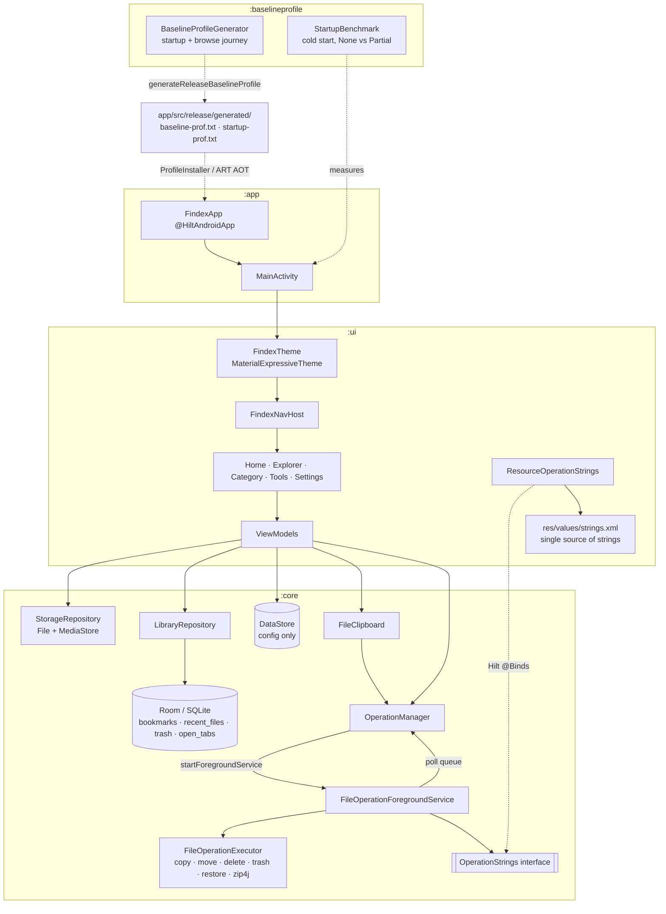

### Module Responsibilities

| Module | Type | Purpose | Localization Rule |
| :--- | :--- | :--- | :--- |
| `:app` | `com.android.application` | Application entry point (`FindexApp` with `@HiltAndroidApp`), `MainActivity`, Android Manifest, system permissions. | **NO `strings.xml`** (pulls merged resources from `:ui`). |
| `:ui` | `com.android.library` | Compose UI components, Material 3 Expressive theming, navigation drawer, screen layouts, ViewModels. | **Centralized `strings.xml`** holding all app strings for future localization. |
| `:baselineprofile` | `com.android.test` | Macrobenchmark module: `BaselineProfileGenerator` records startup + browse paths into `app/src/release/generated/baselineProfiles`; `StartupBenchmark` compares cold start with and without the profile. Regenerate: `./gradlew :app:generateReleaseBaselineProfile` (emulator/device connected). | **NO `strings.xml`**. |
| `:core` | `com.android.library` | Models, repositories, Room database, DataStore settings, operation queue, foreground service, Hilt bindings. | **NO `strings.xml`**. Notification texts come from `OperationStrings`, implemented in `:ui`. |

### Persistence rule

| Store | Holds | Never holds |
| :--- | :--- | :--- |
| Room (SQLite) `findex.db` | Bookmarks, recent files, recycle bin entries, (post-MVP) network drives | Settings |
| DataStore `settings` | Theme mode, dynamic color, hidden files, grid view, sort | Lists / records |

---

## 2. Foreground Service & Long Operations Architecture

Every copy, move, delete, clean, compress and extract runs in `FileOperationForegroundService`.
The UI never runs these on a ViewModel scope.

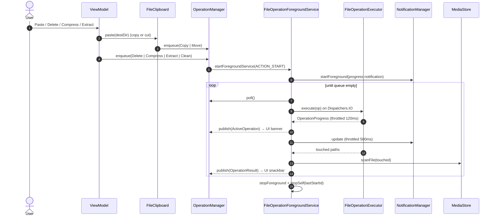

**Cancel**: notification action or UI → `ACTION_CANCEL` → current job cancelled. The executor checks
cancellation every 256 KB chunk, deletes the half-written file, and zip4j tasks get `isCancelAllTasks`.

**Safety rules in the executor**
- Never overwrites: name clashes become `name (1).ext`.
- Refuses to copy/move a folder into itself.
- Move tries `renameTo` first (instant on the same volume), falls back to copy + delete.
- A failed compress deletes the partial archive.

## 3. Storage Hierarchy & Network Drive Integration

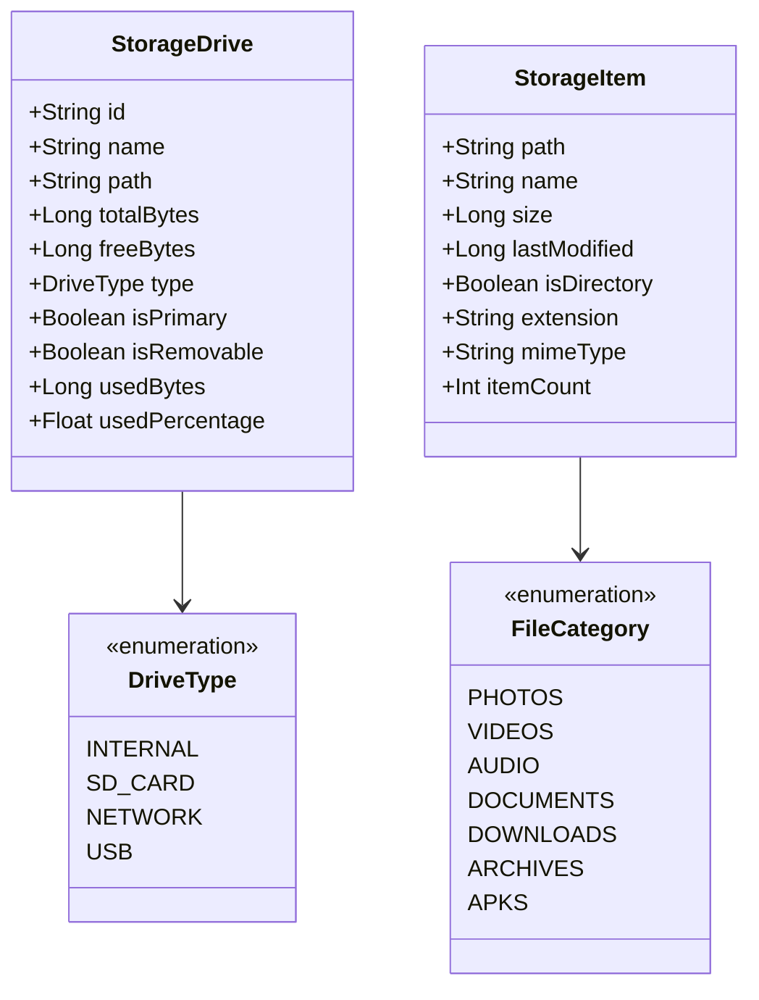

### Multi-protocol network storage (SMB, SFTP, FTP, WebDAV)

Saved network servers live in Room (`network_servers`, schema v5 with `protocol` and `port`). The password is sealed with AES-256-GCM using a key that never leaves the Android Keystore (`CredentialCipher`); the table only holds `iv + ciphertext`.

Every network server opens as a **normal Explorer tab** (`smb://<server id>`), so the global tab strip, clipboard, thumbnails, seekable streaming, and file operations work uniformly across SMB, SFTP, FTP, and WebDAV/WebDAVS.

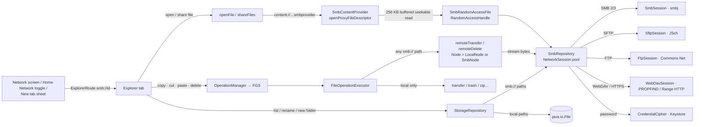

- **Protocols & Default Ports (`NetworkProtocol`)**:
  - `SMB` (`445`): Windows network shares via `smbj` (`SmbSession`), supporting optional subpaths inside a share.
  - `SFTP` (`22`): SSH File Transfer Protocol via `com.github.mwiede:jsch` (`SftpSession`), with offset-based `ChannelSftp.get` for seekable reads.
  - `FTP` (`21`): Passive binary UTF-8 FTP via Apache `commons-net` (`FtpSession`), with `restartOffset` seekable stream reads.
  - `WEBDAV` (`80`) / `WEBDAVS` (`443`): HTTP/HTTPS WebDAV (`WebDavSession`) using SAX `PROPFIND` (Depth 1) multi-status XML parsing, `MKCOL`, `MOVE`, `DELETE`, `PUT`, and `Range: bytes=start-end` partial content requests for seekable streaming.
- Copy / move work in every direction: device → server, server → device, server → server (even across different protocols). A move inside one server is a server-side rename/`MOVE`; everything else streams with progress in the foreground service and deletes a half-written target on failure.
- Delete on a network server is always permanent (`DeleteDialog(permanentOnly)`); there is no recycle bin on the network.
- Compress, extract, archive browse and checksums need local files and are hidden on network shares; the executor also rejects them (`FailureReason.NOT_SUPPORTED`).
- Network errors map to `FailureReason.NETWORK` / `NetworkError` messages instead of crashing a listing.
- `TabSession` restores network tabs while the server is still saved; their title is the server's label.
- Opening or sharing a network file issues a seekable `content://<pkg>.smbprovider/<serverId>/<inner>?size=<bytes>` URI (`SmbContentProvider` + `StorageManager.openProxyFileDescriptor` backed by `SmbRandomAccessFile` with a 256 KB read-ahead window) so default external video/media players stream and seek directly over SMB, SFTP, FTP, and WebDAV without downloading the file first.
- Home **Network** tab: each server is a `NetworkDriveCard` driven by `SmbRepository.probe(id)` → `NetworkStatus` (`Checking` / `Online(space)` / `Offline(error)`). `HomeViewModel` probes new servers and re-probes all on every tab visit; offline cards are disabled with a retry button. Capacity comes from `NetworkSession.space()` (SMB share info, SFTP `statvfs@openssh.com`; FTP and WebDAV report none).

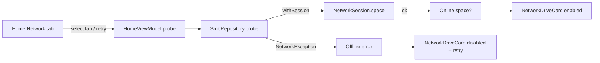

- Room schema v4 adds `network_servers` (`AutoMigration(3, 4)`); Room schema v5 adds `protocol` and `port` (`AutoMigration(4, 5)`).
- **Edit / remove**: long-press a server card (Home Network tab or Network screen, also while offline) for `ServerActionsSheet`. Edit reopens `AddServerSheet` prefilled and calls `SmbRepository.add(existingId = id)`, which re-tests the connection, keeps the current password when the field is left empty, drops the old session and clears the server's cache. Home also opens the add sheet in place instead of navigating to the Network screen.
- **Remember password** (add sheet switch, default on). Off: `passwordCipher` stays null and `rememberPassword = false` (Room v6, `AutoMigration(5, 6)`). The password lives only in `SmbRepository.sessionPasswords` (process memory). Until it is entered, `open()` throws `NetworkError.PASSWORD_REQUIRED`; Home shows a locked card with **Unlock**, the Network screen asks on tap (`UnlockServerDialog` → `SmbRepository.unlock`), and Explorer shows the error as a snackbar.

---

## 3b. Share this phone (LAN web server)

Drawer → **Share this phone** (`ShareRoute` → `ShareScreen`) starts a web server so a browser on the same Wi-Fi or hotspot can browse, download and upload phone files.

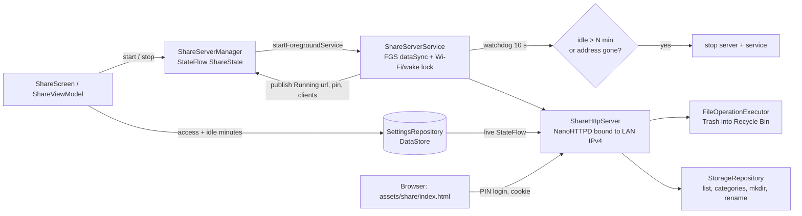

- **Server**: `core/share/ShareHttpServer` (NanoHTTPD). Bound to the site-local IPv4 of Wi-Fi / hotspot / Ethernet only (never mobile data or IPv6), port 8080–8090.
- **Auth**: random 6-digit PIN per start, `POST /api/login` sets an `HttpOnly; SameSite=Strict` session cookie. Wrong PINs lock the IP using `VaultKeyManager.lockoutMs` (5 free, then 30 s doubling). Non-GET calls need `X-Findex: 1` (forces a CORS preflight, blocks cross-site posts).
- **Access** (`SharePermission`: `MEDIA`, `FILES`, `DOWNLOAD`, `UPLOAD`, `MODIFY`) is read from settings on every request, so toggles on the phone apply to signed-in browsers at once. Presets View / Download / Full set the switches.
- **Paths** are canonicalised and must stay inside a storage volume; `.FindexVault` and `.FindexTrash` are never listed or served. Inline HTML/SVG/XML is served as `text/plain`.
- **API**: `/api/info`, `/api/list?path`, `/api/category?c`, `/api/file?path[&dl]` (Range support), `/api/thumb?path`, `PUT /api/upload?dir&name` (raw body, `.part` then rename, `name (n)` on conflict), `/api/mkdir`, `/api/rename`, `/api/delete` (moves to Recycle Bin through `FileOperationExecutor`, already inside a foreground service).
- **Lifetime**: `ShareServerService` stops after `shareIdleMinutes` (default 5, 0 = never) with no request and no running transfer, when the LAN address disappears, from the notification's Stop action, or on Android 15's `dataSync` `onTimeout`.
- **Web app**: one file, `ui/src/main/assets/share/index.html` (no external requests, CSP `'self'`). Tokens copy `Color.kt` and `CategoryTones.kt`, light/dark by `prefers-color-scheme`. Its texts are English-only for now; app strings stay in `ui/res`.

## 4. Standalone Runner (`run.sh`)

For developers without Android Studio installed, `run.sh` provides a complete headless CLI build-and-run workflow:

1. Auto-resolves `ANDROID_HOME` (`$HOME/Android/Sdk`).
2. Checks for running Android devices or emulators via `adb devices`.
3. If no emulator is running, automatically lists AVDs via `emulator -list-avds` and launches the available AVD in the background.
4. Waits for `adb wait-for-device` and polls `sys.boot_completed=1`.
5. Executes `./gradlew :app:installDebug`.
6. Launches `com.aiyu.findex.debug/com.aiyu.findex.MainActivity` with `am start`.
7. Supports `--logs` / `-l` for continuous logcat streaming.

---

## 5. Explorer State & Listing Cache

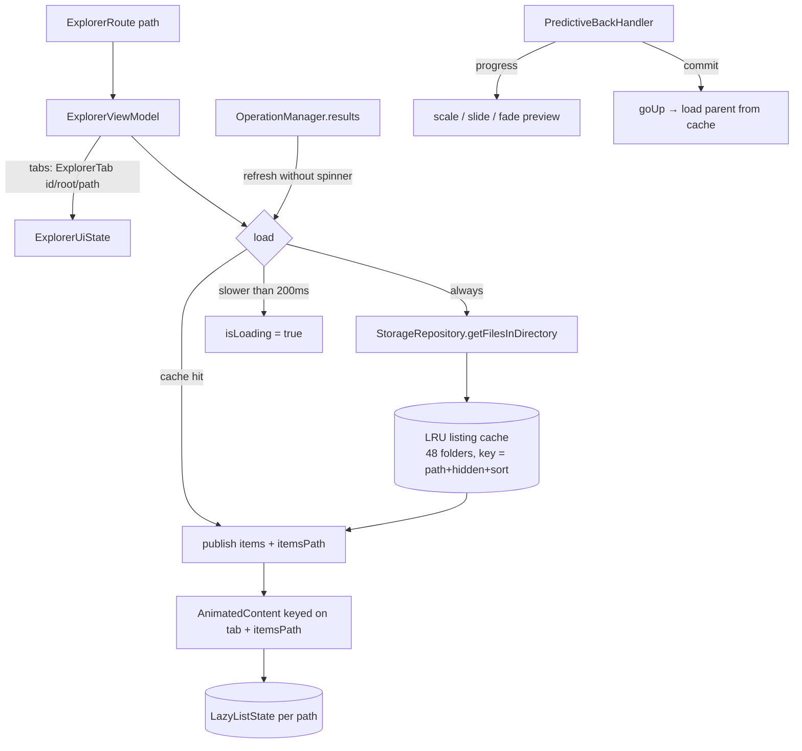

- **Selection** lives in `ExplorerUiState.selection` (paths). Long-press + drag selects a range
  (`dragToSelect` in `ExplorerContent.kt`) with edge auto-scroll; tap toggles while selecting.
- **Clipboard** is app-wide (`FileClipboard`), so copy in one tab and paste in another.

## 5b. Universal Content Thumbnails & Built-in Media Viewer

`findexImageLoader` (`ui/components/Thumbnails.kt`) is Coil's singleton loader, set in `FindexApp`. Every list/grid thumbnail goes through a `Thumb(path, lastModified, isVideo)` model instead of the raw file, so content previews (photos, video frames, audio cover art, PDF first pages, and APK app icons) are decoded only once for both local storage and SMB network shares.

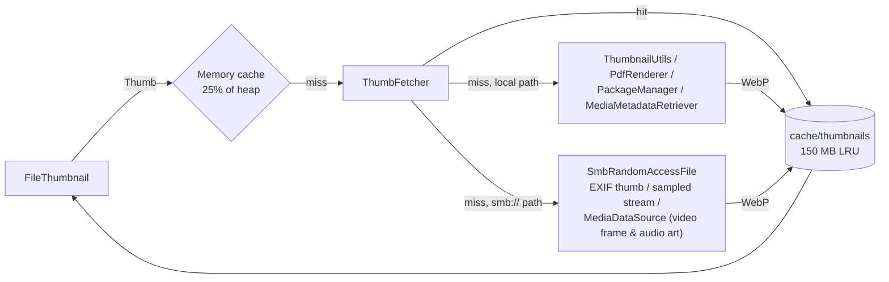

- **Supported Content Previews (`FileThumbnail` + `ThumbFetcher`)**:
  - **Photos & Videos** (local + SMB): `ThumbnailUtils` locally; EXIF thumbnail or sampled stream / `MediaMetadataRetriever` over `SmbRandomAccessFile` on SMB shares. Video thumbnails display a corner play badge.
  - **Audio Cover Art** (local + SMB): `MediaMetadataRetriever.embeddedPicture` extracts embedded album art; files without embedded art are recorded in an in-memory negative cache (`missingThumbKeys`) and fall back to the `FileCategory.AUDIO` tonal icon without re-probing on scroll.
  - **PDF Documents** (local): `android.graphics.pdf.PdfRenderer` renders page `0` onto a 256 px bitmap.
  - **APK Packages** (local): `PackageManager.getPackageArchiveInfo` extracts the application icon drawable and renders it at 256 px.
- The disk cache key (`thumb-v2:<path>:<lastModified>`) includes `lastModified`, so an edited file gets a new thumbnail; old entries are evicted LRU once the cache reaches 150 MB.
- Generation runs on `Dispatchers.IO.limitedParallelism(3)` so fast scrolling never saturates the CPU.

### Built-in Media Gallery Viewer (`MediaViewerDialog`)

Tapping an image in `ExplorerScreen`, `CategoryScreen`, `SearchScreen`, `HomeScreen` (Recents), or `ExplorerDetailPane` opens `MediaViewerDialog` (`ui/explorer/PreviewComponents.kt`), populated with all media items (both **images and videos**) from the active list:

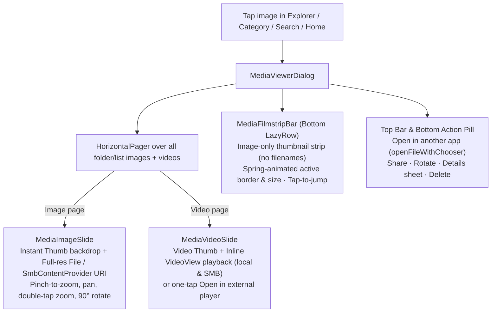

- **Gesture Harmony**: `MediaImageSlide` uses `awaitEachGesture` and only consumes pointer changes when `pointerCount > 1` (pinch-to-zoom) or `scale > 1.01f` (panning while zoomed, releasing at the horizontal edge), allowing single-finger horizontal swipes to pass cleanly to `HorizontalPager` when unzoomed.
- **Bottom Filmstrip**: Displays a horizontal strip of small thumbnail cards for all images and videos in the current list with **only thumbnail images (no filenames)**, spring-animated active highlight (`MaterialTheme.motionScheme.fastSpatialSpec()`), and auto-scroll synchronization with the pager.
- **Default App vs. Open in Another App**: Clicking non-image files (including videos in the file list) opens them directly in the default external app (`Context.openFile`, streaming via `SmbContentProvider` when on SMB), while the viewer and item action sheet (`ItemAction.OPEN_WITH`) offer **Open in another app** (`Context.openFileWithChooser`).

## 6. Tools

| Screen | ViewModel | Data |
| :--- | :--- | :--- |
| Storage Analyzer | `AnalyzerViewModel` | `StorageRepository.getCategoryStats()` + `StorageScanner.largestFiles()` |
| Storage Cleaner | `CleanerViewModel : CleanViewModel<JunkType>` | `StorageScanner.scanJunk()` → `FileOperation.Clean` via FGS |
| WhatsApp Cleaner | `WhatsAppViewModel : CleanViewModel<WhatsAppMediaType>` | `StorageScanner.scanWhatsApp()` → `FileOperation.Clean` via FGS |
| Telegram / Instagram Cleaner | `TelegramViewModel` / `InstagramViewModel : AppMediaViewModel` | `StorageScanner.scanAppMedia(MediaApp)` → `FileOperation.Clean` via FGS |
| App Cleaner | `AppCleanerViewModel : CleanViewModel<AppJunkType>` | `AppJunkScanner.scan()` → `FileOperation.Clean` via FGS |
| Duplicate files | `DuplicatesViewModel` | `StorageScanner.findDuplicates()` → `FileOperation.Trash` / `Delete` via FGS |
| Dual pane | `DualPaneViewModel` | `StorageRepository.getFilesInDirectory()` ×2, `FolderCompare.compare()` → `Copy` / `Move` / `Trash` via FGS |

`StorageScanner` skips `Android/data` and `Android/obb` and never offers top-level standard
folders (DCIM, Music…) or anything under `Android/` as "empty folders". Empty folders are whole
empty trees (only the topmost folder is offered, re-checked on disk). Empty files skip dot-files
such as `.nomedia` and are opt-in.

### App cleaner

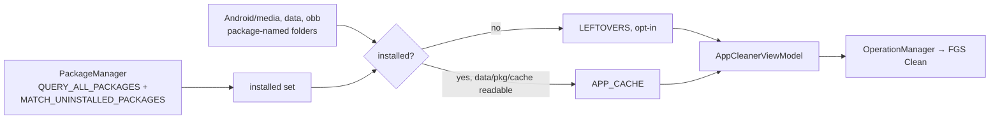

- Without full package visibility an installed app would look removed, so the permission is required.
- Android 11+ hides `Android/data` (and usually `obb`); those folders are skipped, never guessed.

### Dual pane and folder compare

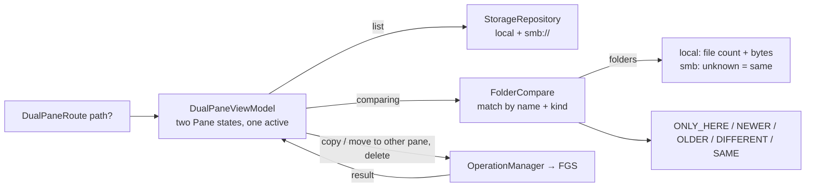

- Stacked in portrait, side by side when the window is wider than tall. Opened from the drawer or the explorer overflow (starts at the tab's folder).
- Files match when sizes are equal and times are within 2 s. "Select missing" picks `ONLY_HERE` items, so copying them never hits a name clash (the executor would add ` (1)`).

### Duplicate finder

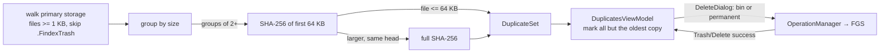

- Only real collisions are read fully; unique sizes are never opened.
- `toggle` refuses to mark the last unmarked copy of a set, so one copy always survives.
- Reachable from the drawer and the Home Quick Tools bento (the rail is already at MD3's 7-item limit).

## 7. Recycle Bin

Delete defaults to `FileOperation.Trash`. Files move (a cheap rename) into `<volume root>/.FindexTrash/` on their own volume. A `trash` row records where each one came from. `Delete permanently` and the bin screen still use `FileOperation.Delete`, which also drops matching `trash` rows.

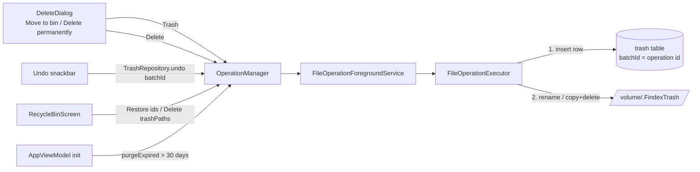

- The row is inserted before the move, so a crash mid-move never leaves an untracked file in the bin.
- Deleting something that is already inside `.FindexTrash` is always permanent.
- `RecycleBinViewModel` drops rows whose file vanished outside the app.
- Room schema v2 adds `trash` through `AutoMigration(1, 2)`.

## 7b. Tab session persistence

`TabSession` (singleton) owns the open tabs. It restores them from the `open_tabs` table on creation and writes every change back, debounced by 300 ms.

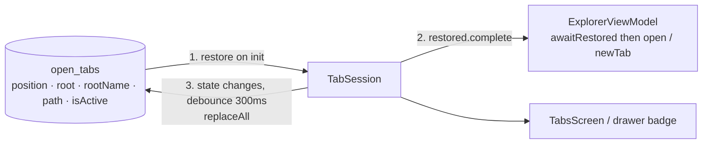

- Tabs whose volume is gone (SD card removed) are dropped; a tab whose folder was deleted falls back to its volume root.
- `ExplorerViewModel` waits for `awaitRestored()` before deciding to open a fresh tab, so a cold start resumes the last session.
- Room schema v3 adds `open_tabs` through `AutoMigration(2, 3)`.

## 7c. Global search

Search uses the MediaStore `Files` table as its index: no second index to build or keep fresh. With all-files access it covers every file and folder MediaStore has scanned on every volume.

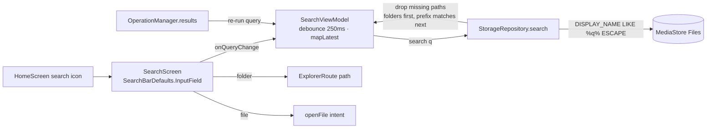

- `%`, `_` and `\` in the query are escaped, so they match literally.
- Results are capped at 300 and filtered to paths that still exist (MediaStore lags behind deletes).
- Known limit: MediaStore skips hidden and `.nomedia` folders.

## 8. Archives

`ArchiveFormat` (core/model) detects formats by suffix, checking `.tar.gz`, `.tgz` and similar before plain extensions. It also records which formats can be written and which take a password.

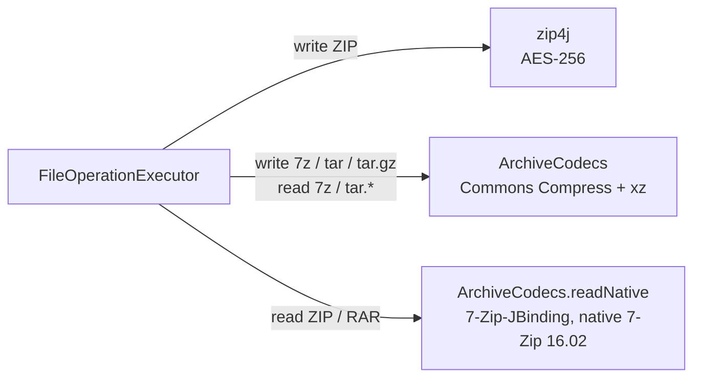

| Format | Create | Extract | Password |
|--------|--------|---------|----------|
| ZIP / ZIPX | yes (zip4j) | yes, every method: Deflate, Deflate64, BZip2, LZMA, PPMd | write AES-256, read AES + ZipCrypto |
| 7z | yes | yes | read only |
| TAR, TAR.GZ | yes | yes | — |
| TAR.XZ, TAR.BZ2 | — | yes | — |
| RAR 4 / RAR 5 | — | yes | read, including encrypted headers |

- **16 KB pages:** the 7-Zip-JBinding-4Android AAR ships 4 KB-aligned `.so` files, which Android 15+ devices with 16 KB pages refuse to load. `core/src/main/jniLibs` holds a 16 KB-aligned rebuild made by `development/scripts/build-7zip-jbinding.sh` (NDK r28). `app` uses `pickFirsts` so those copies win. Rerun the script whenever the AAR version changes.
- Every entry path goes through `ArchiveCodecs.safeTarget` (zip-slip guard). Tar symlinks and hard links are skipped.
- A failed or cancelled extract deletes the new destination folder, and a failed compress deletes the partial archive.
- `uniqueTarget` keeps multi-part suffixes whole: `a (1).tar.gz`.

### In-archive preview

Archives open into `ArchiveScreen` instead of the extract dialog (phone tap, or **Browse contents** in the tablet inspector). Nothing is extracted until a file is opened.

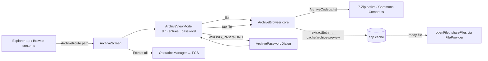

- Rows use virtual `archive!/inner/path` paths (`ArchivePath`) so they reuse `FileList`.
- The password is kept for the screen's lifetime once an entry opens with it.
- Preview copies older than an hour are removed on the next extract.
- Encrypted-header archives (RAR with `-hp`) can't be listed without a password; the screen says so and offers **Extract all**.

---

## 8b. Launch & splash hand-off

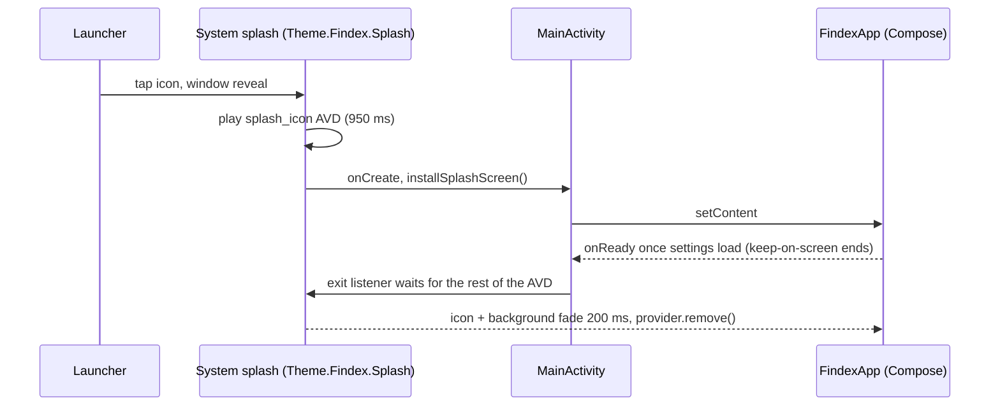

---

## 9. Adaptive Large-Screen & Tablet Architecture

Findex dynamically adapts between compact phones, foldable devices, and expanded tablets:

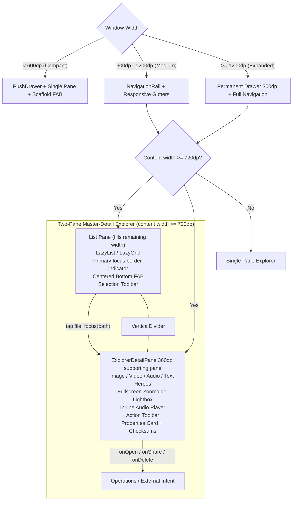

### Architectural Highlights
1. **Window-Size-Aware Navigation**:
   - `< 600dp`: Push drawer (Discord-style off-canvas sheet).
   - `600dp - 1200dp`: Persistent `NavigationRail` (`FindexNavRail`) saving horizontal space.
   - `>= 1200dp`: Permanent full navigation drawer (`FindexDrawerSheet`).
2. **Two-Pane Master-Detail Layout & Inspector**:
   - Left pane (fills remaining width): List or Grid of items. The Floating Action Button is centered at the bottom of the list pane with clear vertical margin, completely avoiding collision with the detail view or border. The active/focused item features an expressive tinted container and a 1.5dp primary border.
   - Middle divider: Clean `VerticalDivider` providing structural separation between panes.
   - Right pane (`ExplorerDetailPane`, fixed `ExplorerDetailPaneWidth = 360.dp`): compact inspector surface with adaptive media heroes (`PreviewComponents`), interactive fullscreen zoom lightbox, in-line audio playback, syntax text reader with line numbers, structured specifications (dimensions, duration, exact byte size), location card with one-tap copy, and on-demand MD5 / SHA-256 checksum calculator.
3. **Readable Gutters**:
   - `readableGutter()` automatically centers content with standard margins on extra-wide screens up to `Dimens.contentMaxWidth = 840.dp`.


## In-app updates

`UpdateRepository` (core) reads the GitHub releases of `aiyu-ayaan/Findex`, picks the newest one on the user's channel (stable / beta / alpha, by version not date), downloads `Findex-<version>.apk` to the cache and hands it to a `PackageInstaller` session. The release body (the CHANGELOG entry) is the release notes. `UpdateDialog` is hosted once in `FindexApp`, so it appears on any screen.

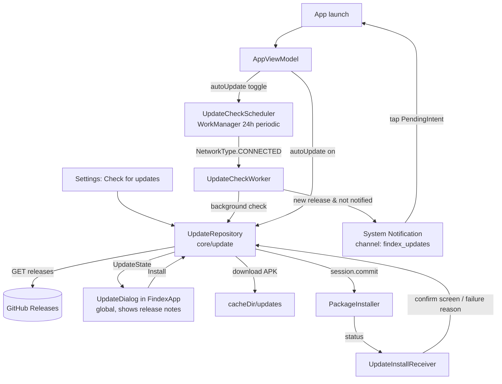

- **Background Daily Check (`UpdateCheckScheduler` + `UpdateCheckWorker`)**:
  - `AppViewModel` observes `settings.autoUpdate` (`distinctUntilChanged`) and calls `UpdateCheckScheduler.sync(enabled)` to schedule or cancel the unique 24-hour periodic `WorkManager` job (`findex_daily_update_check`, constrained to `NetworkType.CONNECTED`).
  - When `UpdateCheckWorker` finds `UpdateState.Available(release, asset)`, it checks `SettingsRepository.lastNotifiedUpdateVersion` so each release version only notifies once, and posts a notification on `findex_updates` (`NOTIFICATION_ID = 1003`) that launches `MainActivity` into `UpdateDialog`.
- Settings → Updates opens `UpdatesScreen` (toggle, channel, manual check). Settings → About opens `AboutScreen` (app, developer, source) → `AcknowledgementsScreen`; both are nav destinations, so back is predictive.

---

## 10. Next features (planned, not built yet)

Full design, schema, contracts and workstream split: [`NEXT_FEATURES_DESIGN.md`](NEXT_FEATURES_DESIGN.md).
Each workstream appends its own subsection here when its feature lands.

### Module view of the new pieces

```mermaid
graph TD
    subgraph ":app"
        MainAct[MainActivity<br/>OPEN_FOLDER shortcut intent]
    end

    subgraph ":ui"
        Nav[FindexNavHost<br/>+14 routes · SelectionHandoff · LaunchRequests]
        Explorer[Explorer<br/>ItemAction: tags · pin · vault · image · compare · backup · batch rename]
        RenameUI[BatchRenameScreen]
        VaultUI[VaultScreen<br/>FLAG_SECURE · BiometricPrompt]
        ToolsUI[LargeFiles · ImageCompressDialog · Compare · GrowthCard]
        NetUI[SyncJobs · SyncJobEdit · DiscoverySheet · ShareServerScreen]
        Viewers[Text · PDF · Audio viewers<br/>InAppViewers.routeFor]
        Library[Favorites · Tags · RecentChanges · DualPane · FolderShortcuts]
        StringsB[ServerStrings / OperationStrings impls]
    end

    subgraph ":core"
        Exec[FileOperationExecutor<br/>dispatch only]
        Renamer[BatchRenamer + RenamePlanner]
        ImgT[ImageTransformer]
        VaultOps[VaultOperations]
        Vault[vault: VaultFormat · VaultKeyManager · VaultSession · VaultContentProvider]
        Sync[sync: SyncEngine · SyncPlanner · SyncScheduler · SyncWorker]
        Disc[NetworkDiscovery<br/>NSD + subnet probe]
        Share[share: ShareServer · ShareServerService]
        Finder[LargeFileFinder · FolderComparer · RecentChangesRepository]
        History[StorageSnapshotWorker · StorageHistoryRepository]
        Tags[TagRepository · PathIndexDao]
        Smb[SmbRepository]
        DB[(Room v7<br/>+ tags · file_tags · vault_meta · vault_items<br/>sync_jobs · sync_file_state · storage_snapshots)]
        KS[[Android Keystore]]
        WM[[WorkManager]]
    end

    MainAct --> Nav
    Nav --> Explorer & RenameUI & VaultUI & ToolsUI & NetUI & Viewers & Library
    Explorer -->|OperationManager| Exec
    RenameUI -->|BatchRename| Exec
    ToolsUI -->|ImageTransform / Trash / Copy| Exec
    VaultUI -->|VaultImport / Export / Delete| Exec
    NetUI -->|Sync now| Exec
    Exec --> Renamer & ImgT & VaultOps & Sync
    VaultOps --> Vault --> KS
    Vault --> DB
    Sync --> Smb
    Sync --> DB
    WM --> Sync
    WM --> History --> DB
    NetUI --> Disc
    NetUI --> Share
    Library --> Tags --> DB
    Renamer --> Tags
    StringsB -. Hilt @Binds .-> Share
```

### Long-work paths

```mermaid
flowchart LR
    UI[UI action] -->|enqueue| OM[OperationManager] --> FGS[FileOperationForegroundService] --> Exec[FileOperationExecutor]
    Exec --> H[BatchRenamer · ImageTransformer · VaultOperations · SyncEngine.runManual]
    Sched[SyncScheduler<br/>unique periodic findex_sync_id] --> W[SyncWorker<br/>setForeground dataSync] --> SE[SyncEngine.run<br/>per-job Mutex]
    H -.same engine.-> SE
    Start[ShareServerScreen Start] --> SS[ShareServerService<br/>own FGS, foreground start only] --> Srv[ShareServer<br/>Wi-Fi IP · PIN · path guard]
```

- Scheduled sync runs in WorkManager's foreground worker, not `OperationManager`: Android 12+ blocks
  starting a foreground service from the background. Manual sync uses the normal queue.
- The share server is a listener, not a queued operation, so it has its own foreground service.

### Vault unlock and file format

```mermaid
flowchart TD
    PW[Password] -->|PBKDF2-SHA256, salt, calibrated iterations| KEK
    KEK -->|AES-GCM unwrap| DEK[(DEK in VaultSession memory)]
    Bio[BiometricPrompt + CryptoObject] -->|Keystore key, auth-bound| DEK
    DEK -->|HKDF fileSalt| FK[per-file key]
    FK --> Blob[".fdxv: header + 64 KiB AES-GCM chunks<br/>nonce = prefix · counter · last flag"]
    DEK -->|HKDF index| IDX[vault_items name / path cipher]
    Blob --> Prov[VaultContentProvider<br/>openProxyFileDescriptor, decrypt on read]
```

### Foundation (W1) as built

Scope of this pass is design ranks 1–9 minus discovery. The foundation therefore ships **only** the
pieces for batch rename, large files, image compress, vault (no share server) and the W5 library and
viewers. Deviations from `NEXT_FEATURES_DESIGN.md` §0:

- **Room v7** adds `tags`, `file_tags`, `vault_meta`, `vault_items`, `storage_snapshots` (no
  `sync_jobs` / `sync_file_state`; sync gets its own `AutoMigration(7, 8)` when it is picked up).
  `PathIndexDao.onMoved` is called from `FileOperationExecutor.transfer(move = true)` and
  `StorageRepositoryImpl.rename`; `likePrefix(dir)` builds the escaped `LIKE` prefix.
- **No** `FileOperation.Sync`, `SyncEngine`, sync `OperationStrings` members, `ShareServerService`,
  `SystemForegroundService` merge, `ACCESS_WIFI_STATE`, `dualPane` / `shareServer*` settings,
  `SyncJobs*`, `ShareServer`, `Compare` routes, or `COMPARE` / `BACKUP_TO_SERVER` item actions.
- `LaunchRequests.folder` is a `MutableStateFlow<String?>`, not a `SharedFlow`: a cold start from a
  pinned shortcut emits before the NavHost collects, and a replay-less `SharedFlow` would drop it.
  The NavHost resets it to `null` after navigating, and only collects once onboarding is done.
- `FailureReason.INVALID_NAME` maps to `error_op_invalid_name` (`error_invalid_name` already existed).
- `FavoritesScreen.onOpenFile` is `(Any) -> Unit`: it takes a viewer route; the screen handles the
  external-app fallback itself.
- `AppViewModel` calls `StorageHistoryScheduler.sync(storageHistory)` (W5 stub, no-op until it lands).
- Selection-toolbar overflow carries Batch rename (2+ items), Compress images (all images, local) and
  Move to vault (local). The item sheet carries Tags, Pin shortcut (folders), Compress images and Move to vault.

```mermaid
flowchart LR
    subgraph Stubs["W1 stubs, bodies owned by"]
        W2s[W2: VaultOperations · VaultContentProvider · VaultScreen/VM]
        W4s[W4: BatchRenamer · ImageTransformer · BatchRenameScreen/VM · ImageCompressDialog/VM · LargeFilesScreen/VM]
        W5s[W5: StorageHistoryScheduler · InAppViewers · FolderShortcuts · Text/Pdf/Audio viewers · Favorites · TaggedFiles · RecentChanges]
    end
    Explorer[Explorer ItemAction] -->|SelectionHandoff token| Routes[Routes.kt]
    Drawer[Drawer 'More' group] --> Routes
    Shortcut[Pinned shortcut intent] --> MainActivity --> LR[LaunchRequests.folder] --> NavHost
    Routes --> NavHost --> Stubs
    Exec[FileOperationExecutor] --> W2s & W4s
    DB[(Room v7: tags · file_tags · vault_meta · vault_items · storage_snapshots)] --> W2s & W5s
```

### Secure vault (W2) as built

Blobs and `vault.key` live in `<primary storage>/.FindexVault/` (with `.nomedia`). Classes in
`core/vault/`: `VaultFormat` (pure JVM crypto, unit-tested), `VaultKeyManager` (PBKDF2 + Keystore
wraps, persistent lockout: 5 free attempts, then 30 s doubling), `VaultSession` (DEK in memory,
auto-lock via `ActivityLifecycleCallbacks`), `VaultRepository` (decrypted list, index rebuild after
reinstall), `VaultContentProvider` (proxy FD, decrypt on read). Deviations from the design:

- Biometric is enrolled after setup with a second prompt (an auth-bound Keystore key needs auth to
  encrypt too), so `create(password)` takes no biometric flag.
- `VaultSession.hold()` returns a `Hold` with a private DEK copy, zeroed on close; long ops never
  lock the session monitor while streaming.
- "Add files" launches the system multi-document picker (`OpenMultipleDocuments`) and maps device storage URIs to paths for `VaultImport` (falling back to the Explorer hint for non-local providers); the main entry path is Explorer `MOVE_TO_VAULT`. Items open through the provider in another app after a warning.
- `.FindexVault` (along with `.FindexTrash`) is excluded from `StorageScanner.walk`, `StorageRepositoryImpl.search` and `RecentChangesRepository.changes`.
- "Restore to original location" removes items from the vault; "Choose folder" (SAF tree mapped to a
  path) saves copies and keeps them in the vault.

```mermaid
flowchart LR
    Explorer[Explorer MOVE_TO_VAULT] -->|SelectionHandoff token| VS[VaultScreen / VaultViewModel]
    VS -->|password / BiometricPrompt| KM[VaultKeyManager] --> Sess[VaultSession DEK]
    VS -->|VaultImport · VaultExport · VaultDelete| OM[OperationManager] --> FGS[Foreground service] --> VO[VaultOperations]
    VO -->|hold: DEK copy| Sess
    VO --> Dir[(.FindexVault/*.fdxv + vault.key)]
    VO --> DB[(vault_items · vault_meta)]
    VS -->|content://pkg.vaultprovider/id| Prov[VaultContentProvider] --> Dir
    Prov -->|withKey| Sess
```

### Batch rename, large files and image compress (W4) as built

- `RenamePlanner` (pure JVM, unit-tested) computes token expansion (`{name}`, `{ext}`, `{n}`, `{date}`, `{parent}`), regex/literal find-replace, case transforms, nested-selection rejection and case-aware sibling clash detection; `RenameSchedule` plans two-phase moves through `.fdxrn-<tag>-<i>` temporary names so swaps and chains never clobber files or `PathIndexDao` rows (`onMovedAll`). `BatchRenameViewModel` loads sibling names for both local folders and `smb://` shares.
- `LargeFilesViewModel` reuses `StorageScanner.largestFiles` (2,000-file top heap, skipping `.FindexVault`, `.FindexTrash`, `Android/data`, `Android/obb`) and filters in memory by size, age, category and hidden-path toggle.
- `ImageTransformer` decodes with power-of-two `inSampleSize` (capped at 48 MP), applies EXIF orientation, skips animated GIF and animated WebP (RIFF/WEBP `VP8X` animation flag), and reports skipped count through `OperationResult.Success(skipped)` to the app-wide snackbar.

### Viewers, tags, shortcuts and history (W5) as built

- `InAppViewers.routeFor` routes local text/code, PDF and audio files from Explorer, Category, Search, Home (bookmarks and recents), Favorites, TaggedFiles and RecentChanges to `TextViewerScreen`, `PdfViewerScreen` and `AudioPlayerScreen`.
- `TagRepository` + `TagDao` persist up to 8-tone tags (`TagTones`) and `file_tags`; `TagDots` render in both `FileList` and `FileGrid`.
- `FolderShortcuts` pins launcher shortcuts targeting `MainActivity` (`ACTION_OPEN_FOLDER` -> `LaunchRequests.folder`).
- `StorageHistoryScheduler` + `StorageSnapshotWorker` record daily volume snapshots into `storage_snapshots`, rendered by `GrowthCard` on `AnalyzerScreen`.
