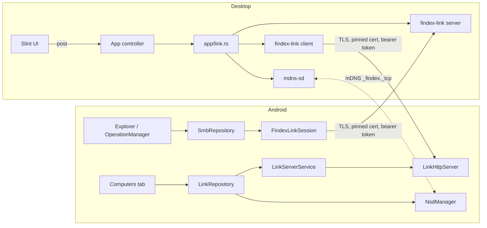

# Ecosystem: Findex Link

Findex Link connects Findex on Android ([aiyu-ayaan/Findex](https://github.com/aiyu-ayaan/Findex)) and Findex on the desktop ([aiyu-ayaan/Findex-Rust](https://github.com/aiyu-ayaan/Findex-Rust)) on the same network:

- The desktop shows paired phones under **Phones** (navigation pane and This PC), with their storage. Phone folders open in normal tabs: browse, open, copy and paste both ways, rename, new folder, delete to the phone's Recycle Bin.
- Android shows paired computers in the **Computers** tab on Home. A computer opens in the normal Explorer like a network share. Copy, paste, open and media streaming all work there.
- **Send** (AirDrop-style push): "Send to phone" on the desktop, "Send to computer" from the phone. Files land in `Downloads/Findex`, and text goes to the clipboard.

This file is the protocol contract. The desktop copy lives at `development/docs/10-ecosystem.md` in the desktop repo. **Change both at once.**

## 1. What Apple does, and what we copied

No Apple binary was analysed: this host is Linux and has none. The sources are Apple's public Platform Security Guide pages [V]:

- AirDrop: <https://support.apple.com/guide/security/airdrop-security-sec2261183f4/web>
- Handoff and Universal Clipboard: <https://support.apple.com/guide/security/handoff-security-secf78dbe639/web>

| Apple | Findex Link |
|---|---|
| Each device has an identity (RSA 2048, tied to the Apple Account). | Each device has a long-term self-signed EC P-256 certificate. Its SHA-256 fingerprint is the device id. Android keeps the key in the Android Keystore, so it never leaves the secure hardware. |
| BLE advertisement carries a short identity hash. Receivers in Contacts Only mode answer only known hashes. | mDNS/DNS-SD `_findex._tcp` with TXT `id` = the first 16 hex characters of the fingerprint, plus `name`, `platform` and `v`. A TXT record is never trusted on its own: TLS checks the full fingerprint on connect. |
| Peer-to-peer Wi-Fi (AWDL) with TLS. | The existing LAN with TLS 1.2/1.3 (rustls / Conscrypt). A typed address works where multicast is blocked (guest Wi-Fi, emulators). |
| Same-account devices trust each other through iCloud Keychain. Other devices need a manual Accept. | No account and no cloud. Two devices become trusted by **pairing** once. After that, a paired device's sends are accepted without a prompt, like your own Apple devices. Unpaired devices can do nothing but ask to pair. |
| Receiver accepts each AirDrop from a stranger. | Pairing needs approval on both screens. |

## 2. Pairing: numeric comparison with commitments

This works like Bluetooth Secure Simple Pairing. A man in the middle can only win by guessing a 6-digit code, with one try per pairing attempt.

```
Phone (client C)                                Desktop (server S)
  nc = random 32 bytes
  POST /v1/pair/start {id: fpC, name, platform,
                       port, commit: SHA256(nc)} ──▶  stores pending, ns = random 32 bytes
                       ◀── {session, nonce: ns, id: fpS, name, platform}
  check id == SHA-256 of the TLS certificate seen
  code = SAS(fpS, fpC, nc, ns)       shows code; user taps Pair if both screens match
  POST /v1/pair/finish {session, nonce: nc,
                        token: T_C}  (TLS now pinned to fpS) ──▶
                                                 check SHA256(nc) == commit
                                                 code = SAS(...); show it; user Accepts
                       ◀── {token: T_S}           store peer {fpC, token_out=T_C, token_in=T_S}
  store peer {fpS, token_out=T_S, token_in=T_C}
```

`SAS = SHA-256("findex-sas-v1" || fpS || fpC || nc || ns)`. Take the first 4 bytes big-endian, mod 1,000,000, zero-padded to 6 digits. The fingerprints and nonces go in as raw 32-byte values.

Shared test vector, checked by `sas::tests` in Rust and `LinkCryptoTest` on Android:

- fpS = `0x11`×32, fpC = `0x22`×32, nc = `0x33`×32, ns = `0x44`×32 → code **`702489`**
- SHA-256(nc) = `deb0e38ced1e41de6f92e70e80c418d2d356afaaa99e26f5939dbc7d3ef4772a`

The client commits to `nc` before it sees `ns`, so an attacker cannot pick its certificate or nonce to force equal codes. Tokens are 256-bit random hex strings and are compared in constant time. Each side issues the token it will accept. The token travels only inside TLS whose server certificate is pinned.

## 3. Transport and API

HTTP/1.1 over TLS, one request per connection (`Connection: close`). The default port is **47100**; if it is taken, a free port is advertised. Every route except `/v1/pair/*` needs `Authorization: Bearer <token>`. Errors come back as `{"error": "<code>"}` with status 400, 401, 403, 404, 409, 413, 416, 429 or 500.

| Route | Purpose |
|---|---|
| `POST /v1/pair/start`, `POST /v1/pair/finish` | Pairing (above). |
| `GET /v1/info` | `{id, name, platform, version, roots: [{name, total, free}]}`: storage for the This PC tiles and the Computers cards. |
| `GET /v1/list?path=` | `{items: [{name, dir, size, mtime}]}`. `mtime` is Unix milliseconds. `/` lists the roots. |
| `GET /v1/stat?path=` | One item. |
| `GET /v1/file?path=` | File bytes. `Range: bytes=a-b` gives `206` with `Content-Range`, which is what lets video and audio seek (streaming). |
| `PUT /v1/file?path=` | Create or replace a file (written to a hidden part file, then renamed). The body has a `Content-Length` or is `Transfer-Encoding: chunked`. The desktop server accepts both; the Android server needs a length (the desktop client always sends one). |
| `POST /v1/mkdir?path=` / `/v1/delete?path=` / `/v1/rename?path=&to=` | Delete goes to the recycle bin and is never permanent. Rename never overwrites. |
| `POST /v1/send?name=` | Push a file to the inbox (`Downloads/Findex`). A taken name gets ` (2)`. |
| `POST /v1/text` | Push text: it is copied to the clipboard and announced. |
| `POST /v1/unpair` | Forget the caller. |

Paths are virtual: `/<root name>/<relative path>`. Components `.`, `..`, empty names and names containing `/ \ : NUL` are refused. On the desktop, the resolved path must stay inside its root after symlinks are followed (canonicalised). Roots:

- Desktop: `Home` and `Received` (the inbox, `Downloads/Findex`). A `PUT` into `Received` counts as a send and is announced like `/v1/send`; Android's "Send to computer" uses it, so the copy runs in the normal operation queue. Shortcut: other drives are not exposed yet.
- Android: one root per storage volume, named as the phone names it (for example `Internal shared storage`, or the SD card label). Names are made unique.

## 4. Where the code is

Desktop (`findex-rust`):

```
crates/findex-link/          protocol crate, no UI
  identity.rs  rcgen certificate + key in $CONFIG/findex/link (owner-only)
  sas.rs       fingerprints, nonces, SAS code, tokens
  http.rs      minimal HTTP/1.1 (head parsing, ranges, percent-encoding)
  server.rs    rustls server, routes, path confinement, pairing state
  client.rs    rustls client with a pinning verifier (still verifies the handshake signature)
  store.rs     peers.json (owner-only)
  discovery.rs mdns-sd advertise + browse
crates/findex-app/src/app/link.rs   UI glue: Phones folder, This PC tiles, dialogs, transfers
```



## 5. Limits (shortcuts)

- A file or folder can't be copied between two phone folders directly. Copy it to the PC first.
- Phone thumbnails are not fetched over the link yet: phone folders show icons only.
- The desktop exposes only Home and its inbox. Android exposes every storage volume.
- No Universal Clipboard (automatic clipboard sync) and no Handoff. Text can be sent by hand.
- mDNS discovery between the Android emulator and the host does not work (NAT). Pair by typed address there.
