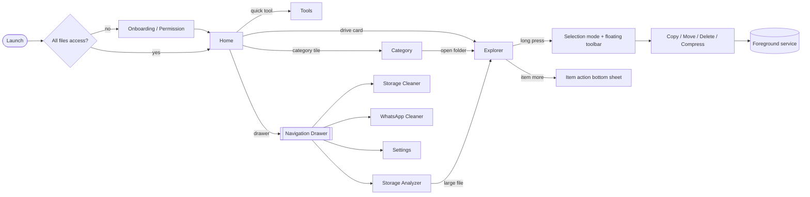

# Findex MVP Plan

Goal: ship a file explorer that feels fully native on Android 12+ and fully exercises
Material 3 Expressive: dynamic color, shape morphing, spring motion, predictive back,
floating toolbars, wavy progress and loading indicators.

The MVP is "everything a person needs every day from a file manager, done beautifully".
Network storage and exotic archive formats come right after MVP (see "Post-MVP").

---

## 1. MVP Scope

| # | Milestone | What ships | Module(s) |
|---|-----------|-----------|-----------|
| M0 | Plan & design | This plan, `DESIGN_SYSTEM.md`, updated architecture, TODO | docs |
| M1 | Design tokens | Complete light/dark schemes (all surface containers), expressive shapes, `MotionScheme.expressive()`, spacing tokens, category tones | `ui` |
| M2 | Core engine | File listing (sort, hidden files), rename, new folder, delete, copy, move, ZIP compress (AES password) & extract, MediaStore category queries, operation queue + foreground service with live notification, clipboard, settings (DataStore) | `core` |
| M3 | App shell | Type-safe Navigation Compose, shared-axis transitions, predictive back, all-files-access onboarding, drawer routing | `ui`, `app` |
| M4 | Home | Storage hero card with wavy progress, Device / Network tabs, category tiles in `MaterialShapes`, quick tools, active-operation banner | `ui` |
| M5 | Explorer | Multi-tab browsing, breadcrumbs, list / grid, sort sheet, long-press + drag-to-select (Google Photos style), floating selection toolbar, item action sheet, rename / new folder / details / compress / extract / delete dialogs, cut-copy-paste across tabs | `ui` |
| M6 | Categories | Photos, Videos, Audio, Documents, Downloads, Archives, APKs via MediaStore with thumbnails | `core`, `ui` |
| M7 | Tools | Storage Analyzer (category breakdown + largest files), Storage Cleaner (junk scan), WhatsApp Cleaner (per-media-type cleanup) | `core`, `ui` |
| M8 | Settings | Theme mode, dynamic color, show hidden files, default view | `core`, `ui` |

### Explicit non-goals for MVP

- SMB / WebDAV / FTP network drives (Network tab stays hidden until a drive exists — the UI contract is already in place).
- 7z / RAR / TAR formats (ZIP only, with AES-256 password).
- Recycle bin, duplicate finder, cloud sync.
- Tab session persistence across process death (tabs live in the ViewModel).

---

## 2. Key Decisions

| Decision | Choice | Why |
|----------|--------|-----|
| UI toolkit | Jetpack Compose + `material3:1.5.0-alpha26` | Only toolkit with M3 Expressive components (floating toolbar, shapes, wavy progress). |
| Navigation | Navigation Compose 2.9 with `@Serializable` routes | Type-safe args, built-in predictive-back animation support. |
| Storage access | `MANAGE_EXTERNAL_STORAGE` (All files access) + `java.io.File` | A file manager needs raw paths; SAF is too slow and fragmented for browsing. |
| Long work | `FileOperationForegroundService` driven by `OperationManager` | CLAUDE.md rule: every long task is a foreground service. The service consumes a queue; UI observes one `StateFlow`. |
| Archives | `zip4j` | Small, pure-Java, supports AES password create + extract. |
| Thumbnails | Coil 3 (+ video frames) | Async decode, memory cache; not worth hand-rolling. |
| Settings | DataStore Preferences | Already in the version catalog. |
| Clipboard | In-memory singleton `FileClipboard` | Shared across tabs = multitasking copy/paste. |

---

## 3. Screen Map

---

## 4. Definition of Done (per milestone)

1. `./gradlew :app:assembleDebug` passes with no new warnings in touched files.
2. Every user-visible string lives in `ui/src/main/res/values/strings.xml`.
3. Light + dark + dynamic color checked; all text pairs use `onX`-on-`X` roles.
4. Touch targets ≥ 48dp; every icon button has a content description.
5. Back gesture is predictable (selection mode → clear selection; deep folder → parent; tab root → previous screen).
6. TODO.md updated, commit in `scope(Change) : Message` format.

---

## 5. Post-MVP

1. Network storage (SMB via smbj, then WebDAV / SFTP).
2. 7z / RAR / TAR via Apache Commons Compress + junrar.
3. Recycle bin and undo for delete.
4. Global search with indexing.
5. Duplicate finder.
6. Tab persistence, tablet two-pane explorer.
