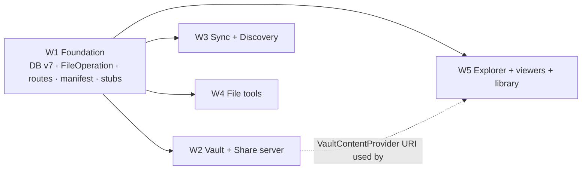

# Findex: Next Features Design

Status: design only. Nothing here is implemented yet. Source of truth for the 12 "Next ideas" in
`development/TODO.md`. Read with `ARCHITECTURE.md` (section 10 mirrors the diagrams) and
`DESIGN_SYSTEM.md`.

Ground rules that every section follows (from `CLAUDE.md`):

- Records in Room (`core/db`). DataStore only for config flags.
- Long file work (copy, move, delete, rename batches, encrypt, transcode, upload) goes through
  `OperationManager` to `FileOperationForegroundService`. Two justified exceptions are called out
  in §5 (sync worker) and §7 (share server).
- Every user-visible string lives in `ui/src/main/res/values/strings.xml`. `core` gets text through
  interfaces bound in `ui` (pattern: `OperationStrings` / `ResourceOperationStrings`).
- Compose + M3 Expressive. Colors through `colorScheme` roles, tones through `CategoryTones` (and the
  new `TagTones`), spacing through `Dimens`, motion through `motionScheme`.
- No new third-party dependencies. Everything below uses the platform or libraries already in
  `gradle/libs.versions.toml`. §15 lists the deps that were considered and rejected.

> **Schema note.** The task brief said "v5 to v6". The code is already at **v6**
> (`AutoMigration(5, 6)` added `rememberPassword`, `core/schemas/.../6.json` is committed).
> The combined migration in this design is therefore **v6 to v7**.

---

## 0. Foundation contract (lands first)

Everything shared is added once, in one commit, by workstream W1. After it lands, the other
workstreams only edit files they own (§13). The contract has five parts.

### 0.1 Database v7 (one combined `AutoMigration(6, 7)`)

All changes are new tables, so Room's auto-migration covers them. No existing column changes.
Entities go in new files (one per feature family) so the big `FindexDatabase.kt` changes only in
its `@Database` header.

`FindexDatabase.kt` edit (the only edit there):

```kotlin
@Database(
    entities = [
        BookmarkEntity::class, RecentFileEntity::class, TrashEntity::class, OpenTabEntity::class, NetworkServerEntity::class,
        // v7
        TagEntity::class, FileTagEntity::class,
        VaultMetaEntity::class, VaultItemEntity::class,
        SyncJobEntity::class, SyncFileStateEntity::class,
        StorageSnapshotEntity::class
    ],
    version = 7,
    exportSchema = true,
    autoMigrations = [ /* 1..6 unchanged */ AutoMigration(from = 6, to = 7) ]
)
abstract class FindexDatabase : RoomDatabase() {
    // existing five daos …
    abstract fun tagDao(): TagDao
    abstract fun vaultDao(): VaultDao
    abstract fun syncDao(): SyncDao
    abstract fun storageSnapshotDao(): StorageSnapshotDao
    abstract fun pathIndexDao(): PathIndexDao
}
```

`CoreModule` gets one `@Provides` per new DAO. `core/schemas/.../7.json` is generated by the build
and committed with the foundation.

#### `core/db/TagEntities.kt`

```kotlin
@Entity(tableName = "tags", indices = [Index(value = ["name"], unique = true)])
data class TagEntity(
    @PrimaryKey(autoGenerate = true) val id: Long = 0,
    val name: String,
    /** Index into TagTones (0..7). Never a raw color. */
    val colorIndex: Int,
    val position: Int,
    val createdAt: Long = System.currentTimeMillis()
)

/** No FK: TagDao deletes children explicitly, so we do not depend on PRAGMA foreign_keys. */
@Entity(tableName = "file_tags", primaryKeys = ["path", "tagId"], indices = [Index("tagId")])
data class FileTagEntity(
    val path: String,
    val tagId: Long,
    val createdAt: Long = System.currentTimeMillis()
)

data class PathTag(val path: String, val tagId: Long, val name: String, val colorIndex: Int)

@Dao interface TagDao {
    @Query("SELECT * FROM tags ORDER BY position ASC, name ASC") fun observeTags(): Flow<List<TagEntity>>
    /** Direct children of [dir] only. [dirLike] = escaped "$dir/%", [deeperLike] = escaped "$dir/%/%". */
    @Query("""SELECT ft.path, t.id AS tagId, t.name, t.colorIndex FROM file_tags ft JOIN tags t ON t.id = ft.tagId
              WHERE ft.path LIKE :dirLike ESCAPE '\' AND ft.path NOT LIKE :deeperLike ESCAPE '\'""")
    fun observeInFolder(dirLike: String, deeperLike: String): Flow<List<PathTag>>
    @Query("SELECT path FROM file_tags WHERE tagId = :tagId ORDER BY createdAt DESC") fun observePaths(tagId: Long): Flow<List<String>>
    @Query("SELECT tagId FROM file_tags WHERE path = :path") suspend fun tagIdsFor(path: String): List<Long>
    @Upsert suspend fun upsertTag(tag: TagEntity): Long
    @Insert(onConflict = OnConflictStrategy.IGNORE) suspend fun assign(rows: List<FileTagEntity>)
    @Query("DELETE FROM file_tags WHERE tagId = :tagId AND path IN (:paths)") suspend fun unassign(tagId: Long, paths: List<String>)
    @Query("DELETE FROM file_tags WHERE path IN (:paths)") suspend fun forgetPaths(paths: List<String>)
    @Query("DELETE FROM file_tags WHERE tagId = :tagId") suspend fun clearTag(tagId: Long)
    @Query("DELETE FROM tags WHERE id = :tagId") suspend fun deleteTagRow(tagId: Long)
    @Transaction suspend fun deleteTag(tagId: Long) { clearTag(tagId); deleteTagRow(tagId) }
}
```

#### `core/db/VaultEntities.kt`

```kotlin
/** Singleton row (id = 1). Mirrors <vault dir>/vault.key so a reinstall can recover with the password. */
@Entity(tableName = "vault_meta")
data class VaultMetaEntity(
    @PrimaryKey val id: Int = 1,
    val formatVersion: Int,             // 1
    val kdfSalt: String,                // base64, 16 bytes
    val kdfIterations: Int,             // PBKDF2-HMAC-SHA256, calibrated, >= 310_000
    val passwordWrappedKey: String,     // base64(iv12 || AES-GCM(KEK, DEK))
    val biometricWrappedKey: String?,   // base64(iv12 || AES-GCM(bioKey, DEK)); null = biometric off
    @ColumnInfo(defaultValue = "0") val failedAttempts: Int = 0,
    @ColumnInfo(defaultValue = "0") val lockoutUntil: Long = 0,
    val createdAt: Long = System.currentTimeMillis()
)

@Entity(tableName = "vault_items", indices = [Index(value = ["blobName"], unique = true)])
data class VaultItemEntity(
    @PrimaryKey(autoGenerate = true) val id: Long = 0,
    val blobName: String,               // "<32 hex>.fdxv", random, says nothing about the file
    val nameCipher: String,             // base64 AES-GCM(DEK-derived index key, display name)
    val originalPathCipher: String,     // same, for "restore to original location"
    val mimeType: String,               // plaintext: needed for thumbnails/filters while locked list is hidden anyway
    val size: Long,                     // plaintext byte size
    val lastModified: Long,             // original mtime
    val addedAt: Long = System.currentTimeMillis()
)

@Dao interface VaultDao {
    @Query("SELECT * FROM vault_meta WHERE id = 1") suspend fun meta(): VaultMetaEntity?
    @Query("SELECT * FROM vault_meta WHERE id = 1") fun observeMeta(): Flow<VaultMetaEntity?>
    @Upsert suspend fun upsertMeta(meta: VaultMetaEntity)
    @Query("SELECT * FROM vault_items ORDER BY addedAt DESC") fun observeItems(): Flow<List<VaultItemEntity>>
    @Query("SELECT * FROM vault_items WHERE id IN (:ids)") suspend fun byIds(ids: List<Long>): List<VaultItemEntity>
    @Query("SELECT * FROM vault_items WHERE id = :id") suspend fun byId(id: Long): VaultItemEntity?
    @Insert suspend fun insert(item: VaultItemEntity): Long
    @Query("DELETE FROM vault_items WHERE id IN (:ids)") suspend fun delete(ids: List<Long>)
    @Query("DELETE FROM vault_items") suspend fun clearItems()
}
```

#### `core/db/SyncEntities.kt`

```kotlin
@Entity(tableName = "sync_jobs", indices = [Index("serverId")])
data class SyncJobEntity(
    @PrimaryKey(autoGenerate = true) val id: Long = 0,
    val name: String,
    val sourcePath: String,             // local absolute folder
    val serverId: Long,                 // network_servers.id
    val destInner: String,              // folder inside the server, no leading slash
    val mode: String,                   // "COPY" | "MIRROR"
    val includeHidden: Boolean = false,
    val wifiOnly: Boolean = true,       // UNMETERED constraint
    val chargingOnly: Boolean = false,
    val intervalHours: Int = 24,        // 0 = manual only; else 6, 12, 24, 168
    val enabled: Boolean = true,
    val createdAt: Long = System.currentTimeMillis(),
    val lastRunAt: Long? = null,
    val lastStatus: String? = null,     // SyncStatus.name: SUCCESS, PARTIAL, FAILED, OFFLINE, PASSWORD_REQUIRED, CANCELLED
    @ColumnInfo(defaultValue = "0") val lastFilesCopied: Int = 0,
    @ColumnInfo(defaultValue = "0") val lastBytesCopied: Long = 0,
    @ColumnInfo(defaultValue = "0") val lastDeleted: Int = 0,
    @ColumnInfo(defaultValue = "0") val lastFailed: Int = 0
)

/** What Findex last uploaded for one file of one job. Change detection runs against this, not the server. */
@Entity(tableName = "sync_file_state", primaryKeys = ["jobId", "relativePath"])
data class SyncFileStateEntity(
    val jobId: Long,
    val relativePath: String,
    val size: Long,
    val lastModified: Long,
    val syncedAt: Long
)

@Dao interface SyncDao {
    @Query("SELECT * FROM sync_jobs ORDER BY createdAt ASC") fun observeJobs(): Flow<List<SyncJobEntity>>
    @Query("SELECT * FROM sync_jobs WHERE id = :id") suspend fun job(id: Long): SyncJobEntity?
    @Query("SELECT * FROM sync_jobs WHERE serverId = :serverId") suspend fun jobsForServer(serverId: Long): List<SyncJobEntity>
    @Upsert suspend fun upsertJob(job: SyncJobEntity): Long
    @Query("SELECT * FROM sync_file_state WHERE jobId = :jobId") suspend fun states(jobId: Long): List<SyncFileStateEntity>
    @Upsert suspend fun upsertStates(rows: List<SyncFileStateEntity>)
    @Query("DELETE FROM sync_file_state WHERE jobId = :jobId AND relativePath IN (:paths)") suspend fun deleteStates(jobId: Long, paths: List<String>)
    @Query("DELETE FROM sync_file_state WHERE jobId = :jobId") suspend fun clearStates(jobId: Long)
    @Query("DELETE FROM sync_jobs WHERE id = :id") suspend fun deleteJobRow(id: Long)
    @Transaction suspend fun deleteJob(id: Long) { clearStates(id); deleteJobRow(id) }
}
```

#### `core/db/StorageSnapshotEntities.kt`

```kotlin
@Entity(tableName = "storage_snapshots", indices = [Index(value = ["volumePath", "day"], unique = true)])
data class StorageSnapshotEntity(
    @PrimaryKey(autoGenerate = true) val id: Long = 0,
    val volumePath: String,
    val day: Long,                      // LocalDate.toEpochDay() in the device zone
    val takenAt: Long,
    val totalBytes: Long,
    val usedBytes: Long,
    @ColumnInfo(defaultValue = "0") val imageBytes: Long = 0,
    @ColumnInfo(defaultValue = "0") val videoBytes: Long = 0,
    @ColumnInfo(defaultValue = "0") val audioBytes: Long = 0,
    @ColumnInfo(defaultValue = "0") val documentBytes: Long = 0,
    @ColumnInfo(defaultValue = "0") val archiveBytes: Long = 0,
    @ColumnInfo(defaultValue = "0") val apkBytes: Long = 0
)

@Dao interface StorageSnapshotDao {
    /** REPLACE, not @Upsert: the conflict is on the (volumePath, day) unique index, not the PK. */
    @Insert(onConflict = OnConflictStrategy.REPLACE) suspend fun put(row: StorageSnapshotEntity)
    @Query("SELECT * FROM storage_snapshots WHERE volumePath = :volume AND day >= :fromDay ORDER BY day ASC")
    fun observe(volume: String, fromDay: Long): Flow<List<StorageSnapshotEntity>>
    @Query("SELECT EXISTS(SELECT 1 FROM storage_snapshots WHERE day = :day)") suspend fun hasDay(day: Long): Boolean
    @Query("DELETE FROM storage_snapshots WHERE day < :beforeDay") suspend fun trim(beforeDay: Long)
}
```

#### `core/db/PathIndexDao.kt` (path maintenance for tags, bookmarks, recents)

Tags and bookmarks are keyed by path, so a move or rename must rewrite them. `from` and `to` are
absolute paths; `fromLike` is the escaped `"$from/%"`.

```kotlin
@Dao interface PathIndexDao {
    @Query("UPDATE OR REPLACE file_tags SET path = :to || substr(path, length(:from) + 1) WHERE path = :from OR path LIKE :fromLike ESCAPE '\\'")
    suspend fun moveTags(from: String, to: String, fromLike: String)
    @Query("UPDATE OR REPLACE bookmarks SET path = :to || substr(path, length(:from) + 1), name = CASE WHEN path = :from THEN :toName ELSE name END WHERE path = :from OR path LIKE :fromLike ESCAPE '\\'")
    suspend fun moveBookmarks(from: String, to: String, toName: String, fromLike: String)
    @Query("UPDATE OR REPLACE recent_files SET path = :to || substr(path, length(:from) + 1) WHERE path = :from OR path LIKE :fromLike ESCAPE '\\'")
    suspend fun moveRecents(from: String, to: String, fromLike: String)
    @Transaction suspend fun onMoved(from: String, to: String) { /* calls the three above */ }
}
```

Callers (foundation adds the one-line hooks): `FileOperationExecutor.transfer(move = true)` after
each successful top-level rename or copy+delete, `StorageRepositoryImpl.rename`, and `BatchRenamer`.
Deletes do not touch the index. Rows whose file is gone are pruned lazily when a list is shown
(`TagRepository.prune`, existing `RecycleBinViewModel` pattern).

### 0.2 `FileOperation` additions (append-only, end of the sealed interface)

```kotlin
// core/model/FileOperation.kt — appended after Clean
/** Renames inside one or more folders. [renames] is the planner output; names only, never paths. */
data class BatchRename(val renames: List<RenameEntry>, override val id: String = UUID.randomUUID().toString()) : FileOperation

data class ImageTransform(val sources: List<String>, val spec: ImageTransformSpec, override val id: String = UUID.randomUUID().toString()) : FileOperation

/** Encrypts [sources] into the vault and deletes the originals permanently (never to the bin). */
data class VaultImport(val sources: List<String>, override val id: String = UUID.randomUUID().toString()) : FileOperation
/** Decrypts vault rows into [destinationDir]; [removeFromVault] deletes the blobs after success. */
data class VaultExport(val itemIds: List<Long>, val destinationDir: String, val removeFromVault: Boolean, override val id: String = UUID.randomUUID().toString()) : FileOperation
data class VaultDelete(val itemIds: List<Long>, override val id: String = UUID.randomUUID().toString()) : FileOperation

/** Manual "Sync now" for one job. Scheduled runs use SyncWorker (§5). */
data class Sync(val jobId: Long, override val id: String = UUID.randomUUID().toString()) : FileOperation

// core/model/FileOperation.kt — new top-level types in the same file
data class RenameEntry(val path: String, val newName: String)

enum class ImageOutputFormat { KEEP, JPEG, WEBP, PNG }
enum class ImageOutputMode { COPY_WITH_SUFFIX, REPLACE, INTO_FOLDER }
data class ImageTransformSpec(
    val maxLongEdgePx: Int? = null,     // null = keep size; mutually exclusive with scalePercent
    val scalePercent: Int? = null,      // 10..100
    val quality: Int = 82,              // 1..100, ignored for PNG
    val format: ImageOutputFormat = ImageOutputFormat.KEEP,
    val output: ImageOutputMode = ImageOutputMode.COPY_WITH_SUFFIX,
    val outputDir: String? = null,      // required for INTO_FOLDER
    val keepMetadata: Boolean = false   // false strips GPS and camera tags
)
```

`FailureReason` gets four values appended **after `UNKNOWN`** (order matters for nothing, but keep
append-only so diffs never collide): `VAULT_LOCKED, NAME_CONFLICT, INVALID_NAME, UNSUPPORTED_IMAGE`.

### 0.3 Executor dispatch (foundation edits `FileOperationExecutor`, then the file is frozen)

Constructor gains the four handlers plus `PathIndexDao`:

```kotlin
class FileOperationExecutor @Inject constructor(
    @ApplicationContext private val context: Context,
    private val trashDao: TrashDao,
    private val smb: SmbRepository,
    private val pathIndex: PathIndexDao,
    private val batchRenamer: BatchRenamer,
    private val imageTransformer: ImageTransformer,
    private val vaultOperations: VaultOperations,
    private val syncEngine: SyncEngine
)
```

- Remote guard: add `ImageTransform`, `VaultImport`, `VaultExport` to the `NOT_SUPPORTED` list.
  `BatchRename` falls through to `executeLocal`; `BatchRenamer` handles `smb://` itself.
- `executeLocal` appends one branch per op, each a single call:
  `batchRenamer.run(op, touched, report)`, `imageTransformer.run(op, touched, report)`,
  `vaultOperations.import/export/delete(op, touched, report)`, `syncEngine.runManual(op.jobId, op.id, report)`.
- `paths()` appends: `BatchRename -> renames.map { it.path }`, `ImageTransform -> sources + listOfNotNull(spec.outputDir)`,
  `VaultImport -> sources`, `VaultExport -> listOf(destinationDir)`, `VaultDelete -> emptyList()`, `Sync -> emptyList()`.

Shared handler shape (each class is `@Singleton @Inject constructor(...)`, owned by its workstream):

```kotlin
suspend fun run(op: FileOperation.X, touched: MutableList<String>, report: (OperationProgress) -> Unit)
```

Foundation ships each handler as a stub whose body is `throw FileOperationException(FailureReason.NOT_SUPPORTED)`,
so the app builds and the owners only replace bodies.

`UiModule` (`operationTitleRes`, `operationCount`, `failureRes`) gets the matching `when` branches and
`op_title_batch_rename`, `op_title_image_transform`, `op_title_vault_import`, `op_title_vault_export`,
`op_title_vault_delete`, `op_title_sync`, plus `error_vault_locked`, `error_name_conflict`,
`error_invalid_name`, `error_unsupported_image`.

`OperationStrings` gets (foundation adds members + `ResourceOperationStrings` impl + strings):

```kotlin
fun syncNotificationTitle(jobName: String): String
fun syncResult(jobName: String, copied: Int, failed: Int): String
fun syncPasswordRequired(jobName: String): String
```

### 0.4 Navigation, drawer, entry points

All routes are declared once in `ui/navigation/Routes.kt` (appended after `UpdatesRoute`):

```kotlin
@Serializable data class BatchRenameRoute(val token: String)
@Serializable data class VaultRoute(val importToken: String? = null)
@Serializable object LargeFilesRoute
@Serializable data class ImageCompressRoute(val token: String)        // dialog destination
@Serializable object SyncJobsRoute
@Serializable data class SyncJobEditRoute(val jobId: Long = 0, val sourcePath: String? = null)
@Serializable object ShareServerRoute
@Serializable data class TextViewerRoute(val path: String)
@Serializable data class PdfViewerRoute(val path: String)
@Serializable data class AudioPlayerRoute(val path: String)
@Serializable object FavoritesRoute
@Serializable data class TaggedFilesRoute(val tagId: Long)
@Serializable data class CompareRoute(val left: String, val right: String? = null)
@Serializable object RecentChangesRoute
```

Large selections never go into a route (Bundle limit ~1 MB). `ui/navigation/SelectionHandoff.kt`:

```kotlin
/** Process-scoped hand-off of a path list to the next screen. Lost on process death: the screen pops with a snackbar. */
object SelectionHandoff {
    fun put(paths: List<String>): String          // returns a UUID token
    fun take(token: String): List<String>?        // one-shot
}
```

`ui/navigation/LaunchRequests.kt`: `object LaunchRequests { val folder: MutableSharedFlow<String>(extraBufferCapacity = 1) }`.
`MainActivity` reads `EXTRA_FOLDER_PATH` (`"com.aiyu.findex.extra.FOLDER_PATH"`) in `onCreate`/`onNewIntent`
and emits it; `FindexNavHost` collects it and navigates to `ExplorerRoute(path)` (§11).

`FindexNavHost` gets one `composable<…>` (or `dialog<ImageCompressRoute>`) per route, calling the
screen function with its final signature (§0.5). Foundation creates each screen file as a stub
(`PlaceholderScreen(onBack)`), and the owner replaces the file body.

Drawer (`FindexDrawer.kt`): a second group under a `HorizontalDivider` with header
`drawer_section_more`: Favorites, Large files, Recent changes, Vault, Sync and backup, Share over Wi-Fi.
The rail stays at 7 items (MD3 limit); new screens are reachable from the drawer and Home tiles.

Explorer entry points (foundation adds the enum values and the dispatch lines; W5 owns the files after):

```kotlin
enum class ItemAction { /* existing … DELETE, */ TAGS, PIN_SHORTCUT, MOVE_TO_VAULT, COMPRESS_IMAGE, COMPARE, BACKUP_TO_SERVER, BATCH_RENAME }
```

| Action | Where shown | Goes to |
|---|---|---|
| `BATCH_RENAME` | selection toolbar overflow, 2+ items | `BatchRenameRoute(SelectionHandoff.put(sel))` |
| `MOVE_TO_VAULT` | item sheet + selection overflow, local only | `VaultRoute(importToken)` |
| `COMPRESS_IMAGE` | item sheet + overflow when every item is an image, local only | `ImageCompressRoute(token)` |
| `COMPARE` | item sheet on a folder | `CompareRoute(left = path)` |
| `BACKUP_TO_SERVER` | item sheet on a local folder, only when a server is saved | `SyncJobEditRoute(sourcePath = path)` |
| `TAGS` | item sheet + overflow | `TagPickerSheet` (W5, in Explorer) |
| `PIN_SHORTCUT` | item sheet on a folder, only if `ShortcutManagerCompat.isRequestPinShortcutSupported` | `Context.pinFolderShortcut` (W5) |

`ExplorerScreen` gains one parameter, `onFeatureRoute: (Any) -> Unit`, wired in the NavHost to
`navController.navigate(it)`.

### 0.5 Settings keys (DataStore, config only)

Foundation adds to `AppSettings` + `SettingsRepository` (key + setter each):

| Key | Type | Default | Owner |
|---|---|---|---|
| `dualPane` | Boolean | false | W5 |
| `storageHistory` | Boolean | true | W5 |
| `textWrap` | Boolean | true | W5 |
| `vaultAutoLockMinutes` | Int | 1 (0 = on leave) | W2 |
| `shareServerPort` | Int | 8686 | W2 |
| `shareServerAllowUploads` | Boolean | false | W2 |

`AppViewModel.init` gets one line: `storageHistoryScheduler.sync(settings.storageHistory)` (same
pattern as `UpdateCheckScheduler`), plus `syncScheduler.reconcile()` to re-enqueue job work after an
app update.

### 0.6 Manifest

`core/src/main/AndroidManifest.xml` (add `xmlns:tools`):

```xml
<uses-permission android:name="android.permission.USE_BIOMETRIC" />
<uses-permission android:name="android.permission.ACCESS_WIFI_STATE" />

<service android:name=".share.ShareServerService" android:exported="false" android:foregroundServiceType="dataSync" />
<provider android:name=".vault.VaultContentProvider" android:authorities="${applicationId}.vaultprovider"
          android:exported="false" android:grantUriPermissions="true" />
<!-- WorkManager's own foreground service needs the type for SyncWorker.setForeground on API 29+ -->
<service android:name="androidx.work.impl.foreground.SystemForegroundService"
         android:foregroundServiceType="dataSync" tools:node="merge" />
```

`app/src/main/AndroidManifest.xml`: no change. `INTERNET`, `ACCESS_NETWORK_STATE`,
`FOREGROUND_SERVICE_DATA_SYNC`, `POST_NOTIFICATIONS` are already declared. Pinned shortcuts need no
permission. NSD needs no permission at `targetSdk 35` (see §6 for the future local-network permission).

---

## 1. Batch rename

**Goal.** Rename many items at once with a pattern, counter, find/replace and case change. Live
preview before apply. Works on local and network paths.

**Core.**

- `core/operation/RenamePlanner.kt` (pure Kotlin, unit-tested):

```kotlin
enum class CaseMode { NONE, LOWER, UPPER, TITLE }
data class RenameRule(
    val pattern: String = "{name}",      // tokens: {name} {ext} {n} {n:3} {date} {date:yyyyMMdd} {parent}
    val find: String = "",
    val replace: String = "",
    val regex: Boolean = false,
    val ignoreCase: Boolean = true,
    val case: CaseMode = CaseMode.NONE,
    val counterStart: Int = 1,
    val counterStep: Int = 1,
    val counterPad: Int = 0,             // {n:3} overrides
    val touchExtension: Boolean = false  // false: rules apply to the base name, extension kept
)
enum class RenameStatus { OK, UNCHANGED, DUPLICATE, EXISTS, INVALID, BAD_REGEX }
data class RenamePreview(val item: StorageItem, val newName: String, val status: RenameStatus)
object RenamePlanner {
    fun plan(items: List<StorageItem>, rule: RenameRule, siblingNames: Map<String, Set<String>>): List<RenamePreview>
}
```

  Order: find/replace, then pattern, then case. `{n}` follows list order (the user's current sort).
  `{date}` uses the item's `lastModified`. Duplicate and exists checks compare **case-insensitively**
  (`/storage/emulated` and FAT SD cards are case-insensitive). A target that is the current name of
  another item in the batch is not `EXISTS`; it is handled by phase 1 below. `INVALID`: empty, `.`,
  `..`, contains `/` or NUL, or > 255 UTF-8 bytes.

- `core/operation/BatchRenamer.kt` (`run(op: BatchRename, …)`):
  1. Re-validate on the IO thread (the folder may have changed since preview). Any conflict fails the
     whole op with `NAME_CONFLICT` / `INVALID_NAME` before touching anything.
  2. Phase 1: items whose target is held by another batch item (cycles like `a↔b`) and case-only
     renames go to a temp name `.fdxrn-<op id first 8>-<i>` in the same folder.
  3. Phase 2: every item renames to its final name (`File.renameTo` or `smb.rename`).
  4. Cancellation is checked between items. On a failure or cancel, completed renames roll back in
     reverse order (best effort); temp names roll back to the original.
  5. `pathIndex.onMoved(old, new)` per success; `touched += old + new`.

**UI.** `ui/rename/BatchRenameScreen.kt` + `BatchRenameViewModel`. Top: pattern field with token
chips (tap inserts), find / replace fields with regex + case toggles, case `ButtonGroup`, counter
row. Below: `LazyColumn` of `old → new` rows; errors get an error-color status chip. Preview
recomputes with `debounce(150)` on `Dispatchers.Default`. The **Apply** FAB is disabled while any row
is not `OK`/`UNCHANGED`; it enqueues `BatchRename` with only the changed rows and pops.

**Edge cases.** 10k items: planner is O(n) with hash sets; preview list is lazy. Items from several
folders (search results): `siblingNames` is per parent. Network share without rename support for
case-only changes: SMB is case-insensitive too, so the two-phase path covers it. Process death
mid-op: temp-named files can remain (`.fdxrn-…`); known limit, visible and harmless, documented.

---

## 2. Secure vault

**Goal.** Files encrypted at rest, unlocked with a password or biometrics.

### 2.1 Decisions

| Topic | Decision |
|---|---|
| Data key | One random 256-bit DEK per vault. Files use per-file keys derived from it. |
| Password | PBKDF2-HMAC-SHA256 (platform `SecretKeyFactory`), 16-byte salt, iterations calibrated at setup to about 600 ms, minimum 310 000. Derived KEK wraps the DEK with AES-256-GCM. |
| Biometric | Optional second wrap of the DEK with an Android Keystore AES-256-GCM key: `setUserAuthenticationRequired(true)`, API 30+ `setUserAuthenticationParameters(0, AUTH_BIOMETRIC_STRONG)`, API 28–29 `setUserAuthenticationValidityDurationSeconds(-1)`, `setInvalidatedByBiometricEnrollment(true)`. Unlock goes through **platform** `android.hardware.biometrics.BiometricPrompt` with a `CryptoObject(cipher)`. API 26–27: password only. |
| Why platform prompt | `androidx.biometric` needs a `FragmentActivity`; `MainActivity` is a `ComponentActivity`, and the platform API covers API 28+. No new dependency. |
| Cipher format | Custom chunked AES-256-GCM (STREAM construction), below. Tink would be the alternative; rejected to keep zero deps. The format is small and fully unit-testable on the JVM. |
| Storage | Blobs in `<primary storage>/.FindexVault/` with `.nomedia` and a `vault.key` recovery header. **Needs user confirmation** (§16): the alternative is app-private `filesDir/vault`, which is wiped on uninstall. |
| Index | Room `vault_items` (names encrypted) + `vault_meta`. If Room is empty but blobs exist (reinstall), the vault offers "Restore" after password entry and rebuilds the index from the encrypted blob headers. |

### 2.2 Blob format `.fdxv` v1

```
offset  size  field
0       4     magic "FDXV"
4       1     version = 1
5       1     log2(chunkSize) = 16  (64 KiB plaintext chunks)
6       16    fileSalt (random)
22      7     noncePrefix (random)
29      4     metaLen (u32 BE)
33      n     meta = AES-GCM(fileKey, nonce = noncePrefix||0xFFFFFFFF||0x02, aad = bytes[0..33)) of
              DataOutput{ utf name, utf mime, long size, long mtime, utf originalPath }
33+n    …     chunks: chunk i = AES-GCM(fileKey, nonce = noncePrefix||u32BE(i)||last?1:0, aad = bytes[0..33)) → ≤64 KiB + 16-byte tag
fileKey = HKDF-SHA256(ikm = DEK, salt = fileSalt, info = "findex-vault-file-v1"), 32 bytes
indexKey = HKDF-SHA256(ikm = DEK, salt = empty, info = "findex-vault-index-v1") encrypts nameCipher / originalPathCipher
```

Truncation fails on the missing `last` flag; reordering fails on the counter; header edits fail on
the AAD. Random access: chunk `i` starts at `33 + n + i * (65536 + 16)`, so video seeking is cheap.

`vault.key` (same folder): `"FDXK" | version | iterations u32 | salt 16 | passwordWrappedKey`. It
lets a reinstall recover with the password. Biometric wrap is never written there (the Keystore key
dies with the app).

### 2.3 Classes (`core/vault/`)

```kotlin
object VaultFormat {                                    // pure, JVM-testable, takes raw key bytes
    fun encrypt(input: InputStream, output: OutputStream, dek: ByteArray, meta: VaultMeta, onChunk: (Long) -> Unit)
    fun readMeta(input: InputStream, dek: ByteArray): VaultMeta
    fun decrypt(input: InputStream, output: OutputStream, dek: ByteArray, onChunk: (Long) -> Unit)
    fun openRandomAccess(file: RandomAccessFile, dek: ByteArray): VaultRandomAccess   // readAt(pos, buf, off, len)
}
@Singleton class VaultKeyManager @Inject constructor(private val dao: VaultDao) {
    suspend fun create(password: CharArray, enableBiometric: Boolean): ByteArray        // returns DEK
    suspend fun unlockWithPassword(password: CharArray): ByteArray                      // throws WrongPassword / LockedOut(until)
    fun biometricCipher(): Cipher?                                                      // null if not enrolled or invalidated
    suspend fun unlockWithBiometric(authenticated: Cipher): ByteArray
    suspend fun changePassword(old: CharArray, new: CharArray)                          // rewraps the DEK only
    suspend fun setBiometric(enabled: Boolean, dek: ByteArray)
}
@Singleton class VaultSession @Inject constructor() {                                    // holds the DEK in memory
    val state: StateFlow<VaultState>                                                    // Locked | Unlocked
    fun open(dek: ByteArray); fun lock()                                                // lock() zero-fills the array
    fun <T> withKey(block: (ByteArray) -> T): T                                         // throws FileOperationException(VAULT_LOCKED)
    fun hold(): AutoCloseable                                                           // running ops keep the session open
}
@Singleton class VaultRepository @Inject constructor(dao: VaultDao, session: VaultSession, keys: VaultKeyManager) {
    fun items(): Flow<List<VaultEntry>>                                                 // names decrypted while unlocked
    suspend fun rebuildIndex(): Int
}
@Singleton class VaultOperations @Inject constructor(…) {                               // executor handler
    suspend fun import(op: FileOperation.VaultImport, touched: MutableList<String>, report: (OperationProgress) -> Unit)
    suspend fun export(op: FileOperation.VaultExport, touched: MutableList<String>, report: (OperationProgress) -> Unit)
    suspend fun delete(op: FileOperation.VaultDelete, touched: MutableList<String>, report: (OperationProgress) -> Unit)
}
class VaultContentProvider : ContentProvider()   // content://<pkg>.vaultprovider/<itemId>, read-only, openProxyFileDescriptor
```

Auto-lock: `VaultSession` registers `Application.ActivityLifecycleCallbacks` (no `lifecycle-process`
dependency). When the started-activity count hits 0, a timer of `vaultAutoLockMinutes` starts; it
locks unless an operation `hold()` is open. Process death locks by definition.

### 2.4 Flows

- **Import**: per file: encrypt to `<blob>.part`, `fd.sync()`, rename to `<blob>.fdxv`, insert the
  row, then delete the original **permanently** (not to the bin, which would keep plaintext). Folder
  sources are flattened into items; the folder structure is kept in `originalPath`. Crash between
  insert and delete leaves the plaintext original: safe, duplicate only.
- **View**: grid of decrypted thumbnails. Images and videos open in the existing `MediaViewerDialog`
  with `content://…vaultprovider/<id>` URIs. Coil requests for vault items use
  `diskCachePolicy(DISABLED)` (memory cache only) so no plaintext thumbnail hits the disk.
- **Export**: "Restore to original folder" or "Save to…"; uses `uniqueTarget`, restores mtime.
- **Open with another app**: allowed only after a confirm dialog that says the other app sees the
  plain file. Share is the same.

### 2.5 UI

`ui/vault/VaultScreen.kt`: states Setup, Locked, Unlocked. Setup: password + confirm, strength
meter, biometric switch, the "no recovery if you forget" warning that must be acknowledged. Locked:
`MaterialShapes` lock illustration, password field, biometric button (auto-prompts once). Unlocked:
grid with selection (same gestures), FAB "Add files" (opens the `NewTabSheet` location picker,
then Explorer in pick mode; the main path is the Explorer `MOVE_TO_VAULT` action), menu: change password, biometric,
auto-lock, lock now. The window gets `FLAG_SECURE` while the route is shown (`DisposableEffect`).
If `importToken` is set, unlock first, then confirm and enqueue `VaultImport`.

### 2.6 Security notes

- The DEK lives only in `VaultSession` memory. Passwords are `CharArray` and zeroed after KDF. The
  password field uses `KeyboardType.Password` with `autoCorrect = false`.
- Wrong password: GCM tag failure. 5 failures start a 30 s lockout, doubling, stored in
  `vault_meta.failedAttempts / lockoutUntil` so restarting the app does not reset it.
- `KeyPermanentlyInvalidatedException` (new fingerprint): drop `biometricWrappedKey`, tell the user,
  require the password, offer to re-enable.
- Deleting originals on flash is not a secure erase. The setup screen says so in one line.
- `mimeType`, `size`, `lastModified` are plaintext in the app-private DB. Names and paths are not.
- `.FindexVault` is excluded from search, cleaner, large-file finder, sync and the share server.

---

## 3. Large and old files finder

**Core.** `core/scanner/LargeFileFinder.kt`:

```kotlin
data class LargeFileQuery(val minBytes: Long, val olderThanDays: Int?, val category: FileCategory?, val includeHidden: Boolean)
@Singleton class LargeFileFinder @Inject constructor(@ApplicationContext context: Context) {
    suspend fun find(query: LargeFileQuery, limit: Int = 2000): List<StorageItem>
}
```

Default path is a MediaStore `Files` query (`SIZE >= ?`, `DATE_MODIFIED <= ?`, `MIME_TYPE IS NOT NULL`),
the same index as search: fast, no walk. With `includeHidden` it walks the primary volume instead
(skips `Android/data`, `Android/obb`, `.FindexTrash`, `.FindexVault`). Results drop missing paths.

**UI.** `ui/tools/LargeFilesScreen.kt` + `LargeFilesViewModel`. Filter chips: size (10 MB, 50 MB,
100 MB, 500 MB, 1 GB), age (any, 30 d, 90 d, 6 mo, 1 yr), category. Header shows the total of the
selection. Rows reuse `FileList` with checkboxes. Delete opens the existing `DeleteDialog`
(bin by default) and enqueues `FileOperation.Trash` / `Delete`; rescans on success (same as
`DuplicatesViewModel`). No new operation, no DB.

**Edge cases.** Android has no reliable access time (`noatime`), so "old" means last modified;
the screen says so. MediaStore misses hidden folders, hence the toggle.

---

## 4. Image compress and resize

**Core.** `core/operation/ImageTransformer.kt` (`run(op: ImageTransform, …)`), per file:

1. Bounds decode (`inJustDecodeBounds`). Target size from `maxLongEdgePx` or `scalePercent`; never upscale.
2. Decode with the largest power-of-two `inSampleSize` that stays ≥ target, then cap at 48 MP
   (further sampling) to avoid OOM. Exact size with `Bitmap.createScaledBitmap(filter = true)`.
3. Apply EXIF orientation (platform `android.media.ExifInterface`), then write orientation NORMAL.
4. Encode to `<target>.part`: JPEG; WEBP via `WEBP_LOSSY` on API 30+, else `WEBP`; PNG lossless.
   `KEEP` keeps the source format, except HEIC/AVIF sources, which become JPEG.
5. Metadata: copy `DateTime*`, `Make`, `Model`; GPS only if `keepMetadata`. JPEG always; PNG/WebP
   only on API 30+ (platform `saveAttributes` limit), else dropped.
6. Rename `.part` to the target. `COPY_WITH_SUFFIX`: `name (resized).jpg` via `uniqueTarget`.
   `REPLACE`: if the result is not smaller and the size did not change, keep the original and count it
   as skipped; otherwise rename over the original. `INTO_FOLDER`: `uniqueTarget` in `outputDir`.
7. Recycle bitmaps per file; check cancellation between files; report bytes as items.

Unsupported: animated GIF/WebP (skipped, counted), corrupt images (`UNSUPPORTED_IMAGE` only if every
file failed; otherwise success with a skipped count in the snackbar). Local only.

**UI.** `ui/imagecompress/ImageCompressDialog.kt`, a `dialog<ImageCompressRoute>` destination (owned
by W4, no Explorer edit): preset `ButtonGroup` (Small 1280, Medium 1920, Large 2560, Custom),
quality slider, format chips, output mode radio, keep-metadata switch, estimated output size
(sampled from the first 3 images). Confirm enqueues and pops.

---

## 5. Folder sync / backup to a network share

**Goal.** One-way device to server, scheduled. Never deletes on the device.

**Core (`core/sync/`).**

```kotlin
enum class SyncMode { COPY, MIRROR }
enum class SyncStatus { SUCCESS, PARTIAL, FAILED, OFFLINE, PASSWORD_REQUIRED, CANCELLED }
sealed interface SyncAction { data class Upload(val rel: String, val file: File) : SyncAction; data class DeleteRemote(val rel: String) : SyncAction }
object SyncPlanner {                                    // pure, unit-tested
    fun plan(local: Map<String, LocalEntry>, state: Map<String, SyncFileStateEntity>, mode: SyncMode): List<SyncAction>
}
@Singleton class SyncEngine @Inject constructor(dao: SyncDao, smb: SmbRepository, strings: OperationStrings) {
    suspend fun run(jobId: Long, report: (OperationProgress) -> Unit): SyncStatus      // one Mutex per job id
    suspend fun runManual(jobId: Long, opId: String, report: (OperationProgress) -> Unit)  // executor handler; maps status to FailureReason
}
@Singleton class SyncScheduler @Inject constructor(@ApplicationContext context: Context, dao: SyncDao) {
    fun schedule(job: SyncJobEntity)                    // unique periodic "findex_sync_<id>", ExistingPeriodicWorkPolicy.UPDATE
    fun cancel(jobId: Long)
    suspend fun reconcile()                             // on app start: enqueue enabled jobs, cancel orphans
}
class SyncWorker(ctx: Context, params: WorkerParameters) : CoroutineWorker(ctx, params)  // EntryPoint pattern like UpdateCheckWorker
@Singleton class SyncRepository @Inject constructor(dao: SyncDao, scheduler: SyncScheduler) { /* CRUD for the UI */ }
```

**Algorithm.**

1. Walk `sourcePath` (skip hidden unless `includeHidden`; always skip `.FindexTrash`, `.FindexVault`,
   `*.part`). Build `rel → (size, mtime)`.
2. `SyncPlanner`: upload when no state row or size/mtime differ. `MIRROR` adds `DeleteRemote` for
   state rows whose file is gone locally. Only files Findex uploaded are ever deleted; unknown server
   files are never touched.
3. Upload: `mkdir` parents (cached set), write `<rel>.fdxsync-part`, then delete the old target if it
   exists and rename the part to the final name. Not atomic on SMB/FTP (no rename-over); a crash
   leaves a `.fdxsync-part` that the next run overwrites.
4. Upsert state rows in batches of 50, so a killed run resumes where it stopped.
5. Per-file failures are counted (`PARTIAL`); a `NetworkException` aborts (`OFFLINE`);
   `NetworkError.PASSWORD_REQUIRED` gives `PASSWORD_REQUIRED` and a notification.
6. Write `lastRunAt / lastStatus / last*` on the job.

**Scheduling and the FGS rule (exception).** Scheduled runs execute inside `SyncWorker`, which calls
`setForeground(ForegroundInfo(id, notification, FOREGROUND_SERVICE_TYPE_DATA_SYNC))`. They do **not**
go through `OperationManager`, because Android 12+ forbids starting a foreground service from the
background (`ForegroundServiceStartNotAllowedException`). WorkManager's own foreground service is the
sanctioned path. Manual "Sync now" uses `FileOperation.Sync` through `OperationManager` as usual. Both
paths share `SyncEngine` and its per-job mutex, so they never run the same job twice. Constraints:
`NetworkType.UNMETERED` if `wifiOnly` else `CONNECTED`, `setRequiresCharging(chargingOnly)`,
`setRequiresBatteryNotLow(true)`. Intervals: 6 h, 12 h, 24 h, 7 d (WorkManager minimum is 15 min).

**Server lifecycle.** `SmbRepository.delete(id)` (W3 owns it) also deletes that server's jobs and
cancels their work, after a confirm that names the affected jobs.

**UI.** `ui/sync/SyncJobsScreen.kt` (list with last status, next run, "Sync now"),
`ui/sync/SyncJobEditScreen.kt` (name, source folder picker, server dropdown, remote folder browser
using `SmbRepository.list`, mode with a mirror warning, interval, Wi-Fi only, charging only).
Entry: drawer, Explorer `BACKUP_TO_SERVER`, and a "Back up a folder" row on the Network screen.

---

## 6. Local network discovery

**Core (`core/network/discovery/`).**

```kotlin
enum class DiscoverySource { MDNS, PORT_PROBE }
data class DiscoveredHost(val address: String, val hostName: String?, val services: Map<NetworkProtocol, Int>, val source: DiscoverySource)
@Singleton class NetworkDiscovery @Inject constructor(@ApplicationContext context: Context) {
    /** Emits the merged, growing host list; completes after [timeoutMs] or when the collector cancels. */
    fun discover(timeoutMs: Long = 12_000): Flow<List<DiscoveredHost>>
}
internal class NsdBrowser(nsd: NsdManager)    // _smb._tcp, _sftp-ssh._tcp, _ssh._tcp, _ftp._tcp, _webdav._tcp, _webdavs._tcp
internal class SubnetProber                   // TCP connect probe
```

- mDNS: `NsdManager.discoverServices` per type. Resolve with `registerServiceInfoCallback` on API 34+;
  older APIs allow one `resolveService` at a time, so resolves are queued.
- Probe: only when the active network is Wi-Fi or Ethernet (`ConnectivityManager` +
  `LinkProperties`). Subnet is the own IPv4 prefix, clamped to the /24 around the device. Ports 445,
  22, 21 (80/443 are skipped: every router answers them). `Socket.connect(timeout = 400 ms)`,
  `Semaphore(48)`, own address excluded. Hostname from mDNS, else `InetAddress.canonicalHostName`
  with a 1 s cap.
- Results merge by address; mDNS wins for names and WebDAV ports.

**UI.** `ui/network/DiscoverySheet.kt` (`ModalBottomSheet`, it is scoped to the add flow). Opened by
a "Find on network" button in `AddServerSheet` and in the Network screen empty state. Live list with
a `LoadingIndicator` while scanning, rows show host, address and protocol chips; tapping a chip
prefills `AddServerSheet(prefill = ServerPrefill(protocol, host, port))`. `AddServerSheet` gains the
`prefill` parameter with a `null` default, so `HomeScreen` needs no change.

**Edge cases.** Guest/AP isolation blocks everything: show "Nothing found" with a hint. VPN active:
probe the Wi-Fi network explicitly (`network.socketFactory`). Android 16+ at a future `targetSdk`
will need the local-network permission (`ACCESS_LOCAL_NETWORK`); track it when `targetSdk` moves.

---

## 7. Share this phone (built-in HTTP server)

**Scope decision.** HTTP only in this pass (browser on the PC, no client install). FTP is post-cut:
a usable FTP server needs PASV data sockets and ~500 lines, or Apache FtpServer + MINA (~1 MB).

**Core (`core/share/`).**

```kotlin
sealed interface ShareServerState { data object Stopped; data object Starting; data class Running(val url: String, val pin: String, val clients: Int); data class Error(val reason: ShareError) }
enum class ShareError { NO_WIFI, PORT_IN_USE, UNKNOWN }
@Singleton class ShareServerController @Inject constructor(@ApplicationContext context: Context, settings: SettingsRepository) {
    val state: StateFlow<ShareServerState>
    fun start(root: String); fun stop()
}
class ShareServer(root: File, bind: InetAddress, port: Int, pin: String, allowUploads: Boolean, strings: ServerStrings)  // ServerSocket accept loop
internal object HttpCodec          // request line + headers parser (8 KB header cap), Range, chunk-free responses
internal object SharePaths         // canonical containment + deny list (pure, unit-tested)
interface ServerStrings { fun pageHtml(): String; val notificationTitle: String; fun notificationText(url: String): String; val stop: String }
class ShareServerService : Service()  // FGS dataSync, ongoing notification with URL + Stop
```

`ServerStrings` is bound in `ui` by `ui/share/ShareStringsModule.kt` (W2 owns it); the HTML page is a
string resource template so it localizes.

**Protocol.**

| Request | Result |
|---|---|
| `GET /` | Single-page HTML + inline JS (list, download, upload, breadcrumbs) |
| `GET /api/list?p=<rel>` | JSON `[{name, dir, size, mtime}]` |
| `GET /f/<rel>` | File, `Range` supported, `Content-Disposition` from name |
| `PUT /f/<rel>` | Upload (only if `allowUploads`): write `.part`, rename via `uniqueTarget` |
| `POST /api/mkdir?p=<rel>` | Only if `allowUploads` |

No delete, no rename, no overwrite over HTTP.

**Security.**

- Bind to the Wi-Fi (or hotspot `ap0`/`swlan0`) IPv4 only, never `0.0.0.0`. Stop when that network goes away.
- Auth: HTTP Basic, password = random 8-char PIN shown on the phone, new per start; constant-time
  compare; 10 failures from one IP block it for 60 s. A session cookie (random 128-bit) avoids
  re-prompting. Plain HTTP on the LAN: the screen warns that others on the same Wi-Fi could sniff
  traffic. TLS is rejected (self-signed cert warnings make it unusable).
- Path guard: decode, normalize, `canonicalPath` must start with the root; deny `.FindexVault`,
  `.FindexTrash`, `Android/data`, `Android/obb`; symlinks are resolved before the check.
- Limits: 8 concurrent connections, 30 s socket read timeout, header cap 8 KB, uploads stop on
  `ENOSPC`. Auto-stop after 30 min with no requests.
- Why not `OperationManager`: the server is a long-lived listener, not a queued operation; it would
  block the queue. It gets its own FGS, started only from the foreground UI.

**UI.** `ui/share/ShareServerScreen.kt`: big Start/Stop button, URL and PIN in large type with copy
buttons, shared-folder picker (default primary storage), allow-uploads switch, port, live client
count, the LAN warning.

---

## 8. Text/code viewer and editor, PDF viewer, audio player

Routing: `ui/viewer/InAppViewers.kt`:

```kotlin
object InAppViewers {
    fun routeFor(item: StorageItem): Any?   // TextViewerRoute / PdfViewerRoute / AudioPlayerRoute / null (external app as today)
}
```

The open paths in Explorer, Category, Search, Home recents and the detail pane call it before
`openFile`. "Open with" stays external.

### 8.1 Text / code

- `core/viewer/TextDocuments.kt`:

```kotlin
data class TextDocument(val text: String, val charset: Charset, val bom: Boolean, val lineEnding: String, val lastModified: Long, val truncated: Boolean, val readOnly: Boolean)
sealed interface SaveResult { data object Saved; data object Conflict; data class Failed(val reason: FailureReason) }
@Singleton class TextDocuments @Inject constructor(smb: SmbRepository) {
    suspend fun load(path: String, editLimit: Long = 2 MB, viewLimit: Long = 8 MB): TextDocument  // throws NotText
    suspend fun save(path: String, text: String, base: TextDocument, force: Boolean = false): SaveResult
}
```

  Binary check: NUL in the first 8 KB. Charset: BOM, then strict UTF-8, then ISO-8859-1. Files over
  `editLimit` open read-only; over `viewLimit` only the first 8 MB load with a banner. Save: same
  charset, BOM and line ending; `Conflict` if `lastModified` moved; local writes go to `.name.fdxtmp`,
  `sync()`, then rename over the original. Remote: `smb.write` directly (no rename-over on SMB/FTP).
  A single save is small file I/O, so it runs on `Dispatchers.IO` in the repository, not the FGS.
- UI `ui/viewer/TextViewerScreen.kt`: `BasicTextField(TextFieldState)` in monospace, line-number
  gutter, wrap toggle (`textWrap`), find bar with match highlight, undo/redo (`TextFieldState.undoState`),
  save FAB when dirty, unsaved-changes dialog on back (predictive back stays enabled when clean).
  Light highlighting (keywords, strings, comments) for json, xml, kt, java, py, js, ts, sh, md, under
  200 KB, via an `OutputTransformation`; colors from `colorScheme` roles.

### 8.2 PDF

`ui/viewer/PdfViewerScreen.kt` + `PdfPageCache`. Platform `PdfRenderer` (local file; remote files
download to cache first with the existing `SmbRepository.download`). One renderer, guarded by a
`Mutex` (not thread-safe). `LazyColumn` of pages rendered at screen width, LRU of 6 bitmaps, pinch zoom
with a re-render at up to 2x after the gesture settles, page indicator and go-to-page. Password PDFs:
API 35+ `LoadParams.setPassword`; older APIs show "Protected PDF" with "Open with".

### 8.3 Audio

`ui/viewer/AudioPlayerScreen.kt` + `AudioPlayerViewModel` with platform `MediaPlayer`. Queue = audio
files of the same folder in the current sort. Play/pause, seek slider, previous/next, repeat and
shuffle, cover art via the existing `Thumb` loader. Network files play from the `SmbContentProvider`
URI. Audio focus via `AudioFocusRequest`; pauses on `ACTION_AUDIO_BECOMING_NOISY`. Playback stops when
the screen leaves. Background playback with a media notification is post-cut (would justify Media3).

---

## 9. Favorites and colored tags

- **Favorites = existing `bookmarks`.** No new table. Bookmarks extend to files (drop the
  `if (item.isDirectory)` guard in `ExplorerSheets`). `FavoritesRoute` lists bookmarks (folders first)
  and the tag list.
- **Tags**: tables in §0.1. `core/repository/TagRepository.kt`:

```kotlin
@Singleton class TagRepository @Inject constructor(dao: TagDao) {
    fun tags(): Flow<List<Tag>>
    fun tagsInFolder(dir: String): Flow<Map<String, List<Tag>>>
    fun filesWithTag(tagId: Long): Flow<List<String>>
    suspend fun create(name: String, colorIndex: Int): Long
    suspend fun rename(id: Long, name: String); suspend fun recolor(id: Long, colorIndex: Int); suspend fun delete(id: Long)
    suspend fun setTags(paths: List<String>, tagIds: Set<Long>)   // diff against current, assign/unassign
    suspend fun prune(paths: List<String>)                         // drop rows for files that no longer exist
}
```

- `ui/theme/TagTones.kt`: 8 tones (container + on-container pairs for light and dark), mirroring
  `CategoryTones`. Screens use `TagTones[index]` only.
- UI: `ui/tags/TagPickerSheet.kt` (chips with check state, "New tag" inline row with color dots),
  `ui/tags/FavoritesScreen.kt`, `ui/tags/TaggedFilesScreen.kt` (reuses `FileList`, prunes missing).
  Explorer rows show up to 3 small tag dots after the name (`FileVisuals.kt`); the folder's map comes
  from `tagsInFolder`.
- Paths follow moves and renames via `PathIndexDao` (§0.1). Network paths can be tagged; they are
  keyed by `smb://<id>/…`, so deleting a server orphans them (pruned lazily).

---

## 10. Compare folders and dual-pane mode

### 10.1 Compare

`core/operation/FolderComparer.kt`:

```kotlin
enum class CompareStatus { ONLY_LEFT, ONLY_RIGHT, NEWER_LEFT, NEWER_RIGHT, SIZE_DIFFERS, CONTENT_DIFFERS, SAME }
data class CompareEntry(val relativePath: String, val left: StorageItem?, val right: StorageItem?, val status: CompareStatus)
@Singleton class FolderComparer @Inject constructor(storage: StorageRepository) {
    suspend fun compare(left: String, right: String, deep: Boolean, onProgress: (Int) -> Unit): List<CompareEntry>
}
```

Recursion goes through `StorageRepository.getFilesInDirectory(showHidden = true)`, so `smb://` works on
either side. Mtime tolerance 2 s (FAT). `deep` hashes same-size pairs with SHA-256 (local only; remote
pairs stay size + mtime). Cap 50 000 entries with a "too large" message. It is a read-only scan, so it
runs in the ViewModel on `Dispatchers.IO` like the duplicate finder.

Actions on a selection: "Copy to right/left" enqueues one `FileOperation.Copy` per target parent folder.
The executor never overwrites, so "Replace older" enqueues `Trash` (local) or `Delete` (network) of the
older targets first, then the `Copy`. The FIFO queue keeps the order.

UI `ui/compare/CompareScreen.kt`: pick the right folder via the `NewTabSheet` location picker when
`right == null`; summary chips per status (filter), list with left/right sizes and dates.

### 10.2 Dual pane on phones

`dualPane` setting (Settings, Explorer overflow toggle). `ui/explorer/DualPane.kt`: landscape shows
panes side by side; portrait stacks them with a draggable divider (40/60 snap points). The primary pane
is today's `ExplorerViewModel`; the secondary pane uses `SecondPaneViewModel` (own path, listing,
selection, through `StorageRepository`, sharing the listing cache rules). Selection toolbar gets
"Copy to other pane" / "Move to other pane", which enqueue `Copy` / `Move` with the other pane's path.
Tablets (≥ 720 dp content) keep the detail pane; dual pane is phone-only.

---

## 11. Pinned folder shortcuts

`ui/shortcuts/FolderShortcuts.kt`:

```kotlin
fun Context.canPinShortcuts(): Boolean = ShortcutManagerCompat.isRequestPinShortcutSupported(this)
fun Context.pinFolderShortcut(path: String, label: String): Boolean
```

`ShortcutInfoCompat` id = `"folder:" + sha1(path)`, short label = folder name, icon = a folder adaptive
icon drawable in `ui/res/drawable`. Intent = `packageManager.getLaunchIntentForPackage(packageName)`
with action `com.aiyu.findex.action.OPEN_FOLDER`, extra `EXTRA_FOLDER_PATH`, `FLAG_ACTIVITY_NEW_TASK
or CLEAR_TOP` (`ui` cannot reference `MainActivity`). `MainActivity` (foundation) forwards the extra to
`LaunchRequests`; the NavHost opens `ExplorerRoute(path)`. A missing folder falls back to its volume
root with a snackbar; a removed server shows the network error snackbar. Uses `androidx.core`, already
a dependency.

---

## 12. Recent changes and storage growth history

### 12.1 Recent changes

`core/repository/RecentChangesRepository.kt`: `suspend fun changes(sinceDays: Int = 7, limit: Int = 500): List<StorageItem>`.
MediaStore `Files`, `DATE_MODIFIED >= ? OR DATE_ADDED >= ?`, not directories, newest first, missing
paths dropped. `ui/changes/RecentChangesScreen.kt`: sticky day headers (Today, Yesterday, date),
category filter chips, range chips (1, 7, 30 days). Known limits: no deletes, no hidden folders
(MediaStore).

### 12.2 Storage growth

- `core/history/StorageSnapshotWorker.kt` (EntryPoint pattern), unique periodic
  `findex_storage_snapshot`, 24 h, `setRequiresBatteryNotLow(true)`, no network.
  `core/history/StorageHistoryScheduler.kt` `sync(enabled)`. `core/history/StorageHistoryRepository.kt`
  `takeSnapshot()` (per mounted volume: `StatFs` total/used; primary volume also gets
  `StorageRepository.getCategoryStats()`), `history(volume, days): Flow<…>`. Also runs once on app
  start when today has no row (WorkManager may defer). `trim(today - 730)` after each write.
- UI: `ui/tools/GrowthCard.kt` inside `AnalyzerScreen`: Canvas line chart of used bytes (no chart
  library), range `ButtonGroup` (30 d, 90 d, 1 yr), headline delta ("+2.3 GB in 30 days"), and the
  largest category deltas. Empty state until two days exist. Colors from `colorScheme` and `CategoryTones`.

---

## 13. Shared files: contract and anchors

Rule: after W1 lands, a shared file is edited **only** by its owner below, and only inside the named
anchor. Everything else in the file is frozen for the parallel phase.

| File | Who edits in W1 | Owner after W1 | Anchor / contract |
|---|---|---|---|
| `core/db/FindexDatabase.kt` | entity list, version 7, `AutoMigration(6, 7)`, dao getters | nobody | Frozen. New queries go into the feature's own `*Entities.kt` DAO; **no column changes** without a new version agreed with W1. |
| `core/db/*Entities.kt` (4 new) + `PathIndexDao.kt` | create with the exact columns of §0.1 | Tag: W5, Vault: W2, Sync: W3, Snapshot: W5, PathIndex: frozen | May add `@Query` methods only. |
| `core/schemas/.../7.json` | generated | nobody | Regenerated only by W1. |
| `core/di/CoreModule.kt` | one `@Provides` per new DAO | nobody | Frozen. Feature classes use `@Inject constructor`, no module edits needed. |
| `core/model/FileOperation.kt` | append ops + `RenameEntry`, `ImageTransformSpec`, enums, `FailureReason` values after `UNKNOWN` | nobody | Frozen. |
| `core/operation/FileOperationExecutor.kt` | constructor, remote guard, `executeLocal` branches, `paths()`, `pathIndex.onMoved` hook in `transfer` | nobody | Frozen. Logic lives in handler classes. |
| Handler stubs `BatchRenamer.kt`, `ImageTransformer.kt`, `VaultOperations.kt`, `SyncEngine.kt` | stub with final signature | W4, W4, W2, W3 | Keep the public signature. |
| `core/operation/OperationStrings.kt` + `ui/di/UiModule.kt` | sync members, `when` branches, failure mapping | nobody | Frozen. Other core text uses its own interface + its own `ui/<feature>/…Module.kt` binding. |
| `core/repository/StorageRepositoryImpl.kt` | `pathIndex.onMoved` in `rename` | nobody | Frozen. |
| `core/network/SmbRepository.kt` | none | W3 | W3 only (delete cascades to sync jobs). |
| `core/settings/SettingsRepository.kt`, `core/model/AppSettings.kt` | all keys of §0.5 | nobody | Frozen. |
| `ui/navigation/Routes.kt` | all routes of §0.4 | nobody | Frozen. |
| `ui/navigation/SelectionHandoff.kt`, `LaunchRequests.kt` | create | nobody | Frozen. |
| `ui/FindexApp.kt` (NavHost) | one `composable`/`dialog` per route, `LaunchRequests` collector, `onFeatureRoute` wiring | nobody | Frozen. Screen signatures below are the contract. |
| `ui/components/FindexDrawer.kt` | "More" group | nobody | Frozen. |
| `ui/explorer/ExplorerSheets.kt` (`ItemAction` + rows), `ExplorerScreen.kt` (dispatch) | enum values + dispatch to routes/stubs | W5 | W5 only. |
| `ui/AppViewModel.kt` | two scheduler lines | nobody | Frozen. |
| `app/.../MainActivity.kt` | intent → `LaunchRequests` | nobody | Frozen. |
| `core/src/main/AndroidManifest.xml` | all of §0.6 | nobody | Frozen. |
| `app/src/main/AndroidManifest.xml` | none | nobody | Unchanged. |
| `gradle/libs.versions.toml`, `*/build.gradle.kts` | none | nobody | No new dependencies in this plan. |
| `ui/src/main/res/values/strings.xml` | region markers + every key W1 itself references | each W inside its own region | See below. |
| `development/docs/ARCHITECTURE.md`, `development/TODO.md` | none | each W appends its own subsection under §10 / ticks its own lines | Append-only, own lines. |

**strings.xml regions.** W1 appends, just before `</resources>`:

```xml
    <!-- region:w1-foundation -->
    …keys W1 uses (nav_*, op_title_*, error_*, action_* for the new ItemActions, sync notification)…
    <!-- endregion:w1-foundation -->
    <!-- region:w2-vault-share -->
    <!-- endregion:w2-vault-share -->
    <!-- region:w3-sync-discovery -->
    <!-- endregion:w3-sync-discovery -->
    <!-- region:w4-file-tools -->
    <!-- endregion:w4-file-tools -->
    <!-- region:w5-explorer-viewers -->
    <!-- endregion:w5-explorer-viewers -->
```

Each workstream inserts only between its own two markers. The unchanged marker lines between regions
keep git merges conflict-free. Never edit existing keys in the parallel phase.

**Screen signatures (NavHost contract).**

```kotlin
BatchRenameScreen(onBack: () -> Unit)                                    // reads token from SavedStateHandle
VaultScreen(onBack: () -> Unit)
LargeFilesScreen(onBack: () -> Unit, onOpenFolder: (String) -> Unit)
ImageCompressDialog(onDismiss: () -> Unit)
SyncJobsScreen(onBack: () -> Unit, onEdit: (Long) -> Unit, onNew: () -> Unit)
SyncJobEditScreen(onBack: () -> Unit)
ShareServerScreen(onBack: () -> Unit)
TextViewerScreen(onBack: () -> Unit)
PdfViewerScreen(onBack: () -> Unit)
AudioPlayerScreen(onBack: () -> Unit)
FavoritesScreen(onBack: () -> Unit, onOpenFolder: (String) -> Unit, onOpenTag: (Long) -> Unit, onOpenFile: (Any?) -> Unit)
TaggedFilesScreen(onBack: () -> Unit, onOpenFolder: (String) -> Unit)
CompareScreen(onBack: () -> Unit)
RecentChangesScreen(onBack: () -> Unit, onOpenFolder: (String) -> Unit)
```

---

## 14. Workstreams

Five workstreams. W1 lands first and alone; W2–W5 then run in parallel with disjoint files.

| WS | Features | Files owned (new unless marked) | Model | Size |
|---|---|---|---|---|
| **W1 Foundation** | Contract of §0 | Every "W1 edits" row of §13, the 4 entity files, `PathIndexDao.kt`, `7.json`, handler stubs, screen stub files, `SelectionHandoff`, `LaunchRequests`, `ItemAction` wiring | **opus** | M (mostly declarations; must build green and keep every existing feature working) |
| **W2 Vault + share server** | §2, §7 | `core/vault/*`, `core/share/*`, `core/operation/VaultOperations.kt` (body), `core/db/VaultEntities.kt` (queries), `ui/vault/*`, `ui/share/*` (incl. `ShareStringsModule.kt`), tests `core/src/test/.../vault/VaultFormatTest.kt`, `.../share/SharePathsTest.kt` | **opus** (crypto, Keystore, sockets, path guard) | XL |
| **W3 Sync + discovery** | §5, §6 | `core/sync/*`, `core/network/discovery/*`, `core/operation/SyncEngine.kt` (body), `core/db/SyncEntities.kt` (queries), `core/network/SmbRepository.kt`, `ui/sync/*`, `ui/network/*` (incl. `DiscoverySheet.kt`, `AddServerSheet` prefill), test `SyncPlannerTest.kt` | **opus** (scheduling, resumable remote writes, concurrency) | L |
| **W4 File tools** | §1, §3, §4, §10.1 | `core/operation/RenamePlanner.kt`, `BatchRenamer.kt`, `ImageTransformer.kt`, `FolderComparer.kt`, `core/scanner/LargeFileFinder.kt`, `ui/rename/*`, `ui/imagecompress/*`, `ui/compare/*`, `ui/tools/LargeFilesScreen.kt` + its ViewModel file, tests `RenamePlannerTest.kt`, `FolderComparerTest.kt` | **sonnet** (opus review of `BatchRenamer` two-phase logic recommended) | L |
| **W5 Explorer + viewers + library** | §8, §9, §10.2, §11, §12 | `core/viewer/*`, `core/repository/TagRepository.kt`, `RecentChangesRepository.kt`, `core/history/*`, `core/db/TagEntities.kt` + `StorageSnapshotEntities.kt` (queries), `ui/viewer/*`, `ui/tags/*`, `ui/changes/*`, `ui/shortcuts/*`, `ui/theme/TagTones.kt`, `ui/tools/GrowthCard.kt`, **existing** `ui/explorer/*`, `ui/components/FileVisuals.kt`, `ui/category/*`, `ui/search/*`, `ui/home/*`, `ui/tools/AnalyzerScreen.kt`, `ui/settings/SettingsScreen.kt` | **sonnet** | XL (split dual pane out if it runs long) |

**Order.**



1. W1 lands, builds (`./gradlew :app:assembleDebug`), existing unit tests pass, `7.json` committed.
2. W2–W5 start from that commit. Each builds green on its own branch and merges in any order.
   Only soft link: W5's viewer can open vault items once W2's provider exists; W2 uses the
   existing `MediaViewerDialog`, so neither blocks the other.
3. Each workstream appends its own subsection to `ARCHITECTURE.md` §10 and ticks its TODO lines.

---

## 15. Dependencies considered and rejected

| Library | For | Why not |
|---|---|---|
| Tink | vault streaming AEAD | ~1.5 MB; the chunked GCM format is ~200 lines on `javax.crypto` and testable |
| androidx.biometric | biometric prompt | needs `FragmentActivity`; platform `BiometricPrompt` (API 28+) does the job |
| Argon2 (e.g. argon2kt) | KDF | native lib; PBKDF2 with calibrated iterations is acceptable for a local vault |
| Apache FtpServer / NanoHTTPD | share server | FTP is post-cut; HTTP needs only GET/PUT/Range, small enough to own |
| Media3 | audio | only needed for background playback, which is post-cut |
| zxing | QR code for the server URL | nice-to-have; URL + PIN text is enough for pass one |
| Chart libraries | growth graph | one line chart on `Canvas` |
| androidx.hilt:hilt-work | workers | existing `EntryPoint` pattern already works |

---

## 16. Decisions needed from the user

1. **Vault location.** Recommended: `<primary>/.FindexVault/` (survives uninstall, recoverable with
   the password through `vault.key`). Alternative: app-private `filesDir/vault` (invisible to other
   apps, but **wiped on uninstall**).
2. **FGS rule exception for scheduled sync.** Scheduled runs use WorkManager's foreground worker
   instead of `OperationManager` because Android 12+ blocks starting a foreground service from the
   background. Manual sync still uses `OperationManager`. Approve, or drop scheduling.
3. **Share server = HTTP only, no TLS, PIN auth** in this pass; FTP later.
4. **Schema** is v6 in code, so the migration is v6 → v7.

---

## 17. String key families (names only)

Grouped by region. English text to be written later.

- **W1 foundation**: `drawer_section_more`; `nav_favorites`, `nav_large_files`, `nav_recent_changes`,
  `nav_vault`, `nav_sync`, `nav_share_server`; `action_batch_rename`, `action_move_to_vault`,
  `action_compress_image`, `action_compare`, `action_backup_to_server`, `action_tags`,
  `action_pin_shortcut`; `op_title_batch_rename`, `op_title_image_transform`, `op_title_vault_import`,
  `op_title_vault_export`, `op_title_vault_delete`, `op_title_sync`; `error_vault_locked`,
  `error_name_conflict`, `error_invalid_name`, `error_unsupported_image`; `sync_notification_title`,
  `sync_notification_result`, `sync_notification_password_required`; `placeholder_coming_soon`;
  `selection_expired`.
- **rename_** (W4): `rename_title`, `rename_pattern_label`, `rename_token_*` (name, ext, counter,
  date, parent), `rename_find_label`, `rename_replace_label`, `rename_regex`, `rename_ignore_case`,
  `rename_case_*` (none, lower, upper, title), `rename_counter_start`, `rename_counter_step`,
  `rename_counter_pad`, `rename_touch_extension`, `rename_status_*` (unchanged, duplicate, exists,
  invalid, bad_regex), `rename_apply`, plural `rename_summary`.
- **bigfiles_** (W4): `bigfiles_title`, `bigfiles_size_*`, `bigfiles_age_*`, `bigfiles_category_any`,
  `bigfiles_include_hidden`, `bigfiles_hint_modified`, `bigfiles_empty`, plural `bigfiles_selected`.
- **imgc_** (W4): `imgc_title`, `imgc_preset_*` (small, medium, large, custom), `imgc_max_edge`,
  `imgc_scale_percent`, `imgc_quality`, `imgc_format_*` (keep, jpeg, webp, png), `imgc_output_*`
  (copy, replace, folder), `imgc_keep_metadata`, `imgc_estimate`, `imgc_replace_warning`, plural `imgc_skipped`.
- **compare_** (W4): `compare_title`, `compare_pick_right`, `compare_deep`, `compare_status_*` (7),
  `compare_copy_to_left`, `compare_copy_to_right`, `compare_replace_older`, `compare_too_large`, `compare_identical`.
- **vault_** (W2): `vault_title`, `vault_setup_*` (title, password, confirm, mismatch, strength_*,
  biometric, warning_no_recovery, warning_not_secure_erase, acknowledge, create), `vault_unlock_*`
  (title, password, biometric, wrong_password, lockout), `vault_biometric_prompt_*` (title, subtitle,
  negative), `vault_biometric_invalidated`, `vault_add_files`, `vault_import_confirm`, `vault_export_*`
  (original, choose_folder), `vault_open_external_warning`, `vault_menu_*` (change_password,
  biometric, auto_lock, lock_now), `vault_auto_lock_*`, `vault_restore_*` (title, body, action),
  `vault_empty`, `vault_locked_banner`, `cd_vault_lock`.
- **share_server_** (W2): `share_server_title`, `share_server_start`, `share_server_stop`,
  `share_server_url_label`, `share_server_pin_label`, `share_server_copy`, `share_server_folder`,
  `share_server_allow_uploads`, `share_server_port`, plural `share_server_clients`,
  `share_server_lan_warning`, `share_server_error_*` (no_wifi, port_in_use, unknown),
  `share_server_notification_*` (title, text, stop), `share_server_page_html`.
- **sync_** (W3): `sync_title`, `sync_new_job`, `sync_empty`, `sync_now`, `sync_field_*` (name,
  source, server, remote_folder, mode, interval, wifi_only, charging_only, include_hidden),
  `sync_mode_*` (copy, mirror, mirror_warning), `sync_interval_*` (manual, 6h, 12h, 24h, 7d),
  `sync_status_*` (6), `sync_last_run`, `sync_next_run`, `sync_never_run`, `sync_delete_job_*`,
  `sync_server_delete_warning`, `sync_back_up_folder`.
- **discover_** (W3): `discover_title`, `discover_action`, `discover_scanning`, `discover_empty`,
  `discover_empty_hint`, `discover_source_*` (mdns, probe), `discover_retry`.
- **viewer_text_ / viewer_pdf_ / viewer_audio_** (W5): `viewer_text_*` (save, saved, unsaved_title,
  unsaved_body, discard, conflict_title, conflict_body, overwrite, read_only, truncated, not_text,
  find, wrap, undo, redo, encoding), `viewer_pdf_*` (page_of, go_to_page, protected, password,
  downloading, error), `viewer_audio_*` (play, pause, next, previous, repeat, shuffle, queue, error).
- **tags_ / favorites_** (W5): `tags_title`, `tags_new`, `tags_name_hint`, `tags_color_*` (8 color
  names for accessibility), `tags_rename`, `tags_delete_*`, `tags_empty`, `favorites_title`,
  `favorites_folders`, `favorites_files`, `favorites_tags`, `favorites_empty`.
- **dualpane_** (W5): `dualpane_toggle`, `dualpane_copy_here`, `dualpane_move_here`, `settings_dual_pane`,
  `settings_dual_pane_desc`.
- **shortcut_** (W5): `shortcut_pinned`, `shortcut_unsupported`, `shortcut_folder_missing`.
- **changes_ / growth_** (W5): `changes_title`, `changes_today`, `changes_yesterday`,
  `changes_range_*` (1d, 7d, 30d), `changes_empty`, `changes_limit_hint`, `growth_title`,
  `growth_range_*` (30d, 90d, 1y), `growth_delta_up`, `growth_delta_down`, `growth_empty`,
  `settings_storage_history`, `settings_storage_history_desc`.

---

## 18. Priority and cut line

| Rank | Feature | Why |
|---|---|---|
| 1 | Batch rename | high value, low risk |
| 2 | Large and old files finder | reuses MediaStore + Trash, small |
| 3 | Text/code, PDF, audio viewers | daily use; removes app hops |
| 4 | Favorites and tags | small schema, visible everywhere |
| 5 | Image compress/resize | common need, contained |
| 6 | Secure vault | high value, highest risk; needs careful review |
| 7 | Network discovery | makes network setup easy |
| 8 | Pinned shortcuts | tiny |
| 9 | Recent changes + growth graph | nice insight, low risk |
| 10 | Folder sync/backup | valuable but complex (scheduling, resumable writes) |
| 11 | Compare folders | niche |
| 12 | Share this phone (HTTP) | security surface; needs its own review |
| 13 | Dual pane on phones | invasive Explorer change |

**Cut line for one pass: ranks 1–9.** Run W1, W4 without compare, W5 without dual pane, W2 vault
only, W3 discovery only. Defer sync (W3), share server (W2), compare (W4), dual pane (W5), FTP
server, background audio and QR codes. The foundation still lands complete (routes, tables, ops), so
the deferred items need no second migration.

---

## 19. Tests (each workstream leaves these)

- `RenamePlannerTest`: tokens, counters, regex errors, case-insensitive duplicates, cycles.
- `VaultFormatTest`: round trip, wrong key, flipped byte, truncated file, reordered chunks, random access.
- `SharePathsTest`: `..`, encoded `%2e%2e`, symlink escape, deny list.
- `SyncPlannerTest`: new, changed, unchanged, mirror deletes only known files.
- `FolderComparerTest`: temp dirs, mtime tolerance, deep hash.
