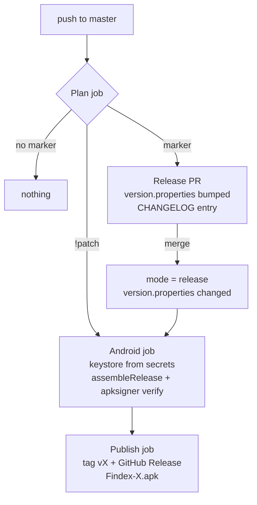

# Release

Same flow as Domus. Workflow: `.github/workflows/release.yml`. Version maths: `scripts/release-version.mjs`.

## Markers

Put a marker at the **start** of a commit subject on `master`:

| Marker | Example | Result |
| :--- | :--- | :--- |
| `!alpha` | nothing released → `0.0.1-alpha.1`; `0.0.1-alpha.1` → `0.0.1-alpha.2` | pre-release |
| `!beta` | `0.0.1-alpha.3` → `0.0.1-beta.1` | pre-release |
| `!stable` | `0.0.1-beta.2` → `0.0.1` | stable |
| `!fix` / `!feat` / `!major` | `1.4.2` → `1.4.3` / `1.5.0` / `2.0.0` | stable |
| `!patch` | `0.0.2` → `0.0.2` | rebuild the released version in place |

Example: `!alpha ui(Explorer) : Add drag-to-select`. Several markers in one push: the strongest wins.

## Flow

- `version.properties` holds `version` (versionName) and `build` (versionCode). Only the release PR changes it.
- Manual run: Actions → Release → Run workflow, `mode` = `pr` / `release` / `patch`.
- The baseline profile is committed, so CI needs no device.

## Secrets

| Secret | Value |
| :--- | :--- |
| `ANDROID_KEYSTORE_BASE64` | `base64 -w0 ~/Keys/aiyu-soft-android-keys.jsk` |
| `ANDROID_KEYSTORE_PASSWORD` | store password |
| `ANDROID_KEY_ALIAS` | `findex` |
| `ANDROID_KEY_PASSWORD` | key password |
| `RELEASE_TOKEN` (optional) | PAT, only if Actions may not open PRs |

Also enable Settings → Actions → General → "Allow GitHub Actions to create and approve pull requests".
